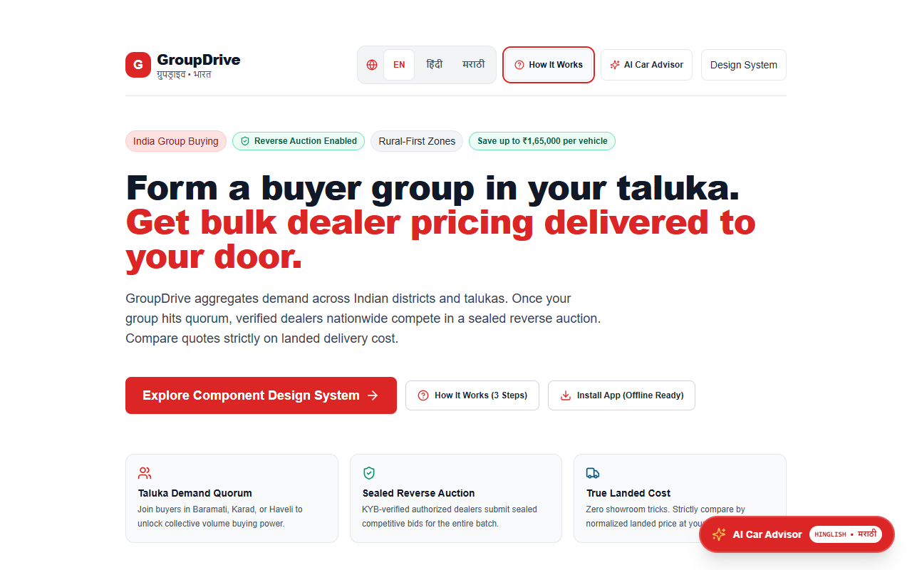
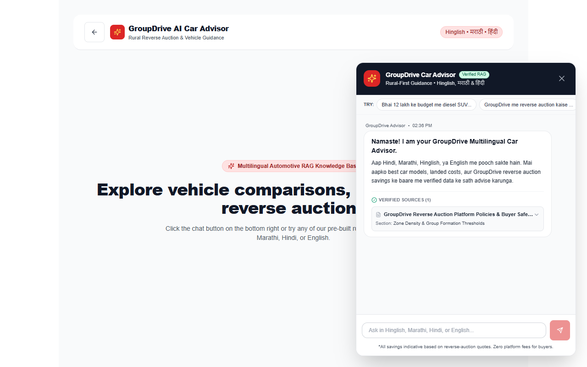
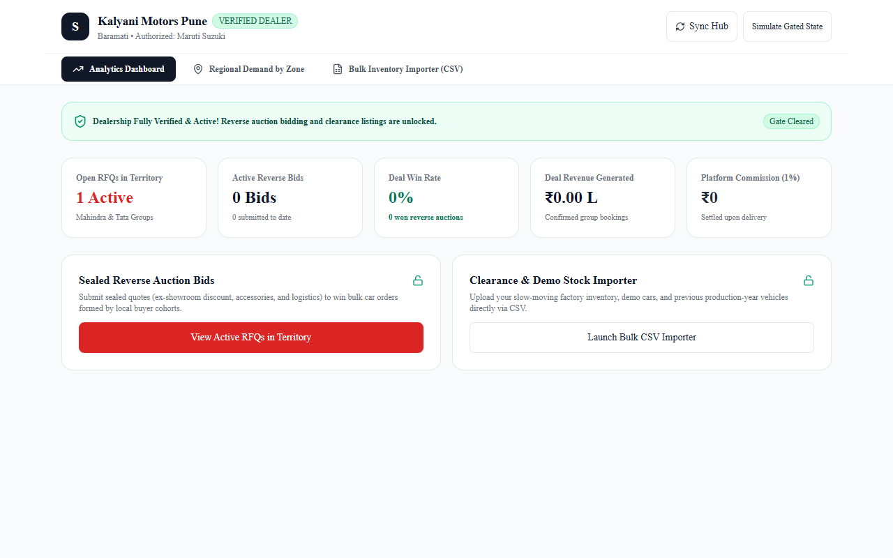
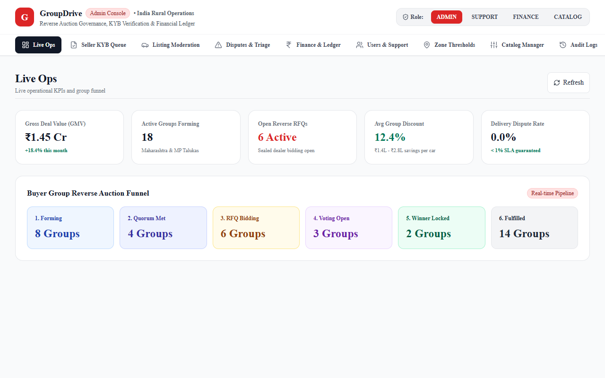
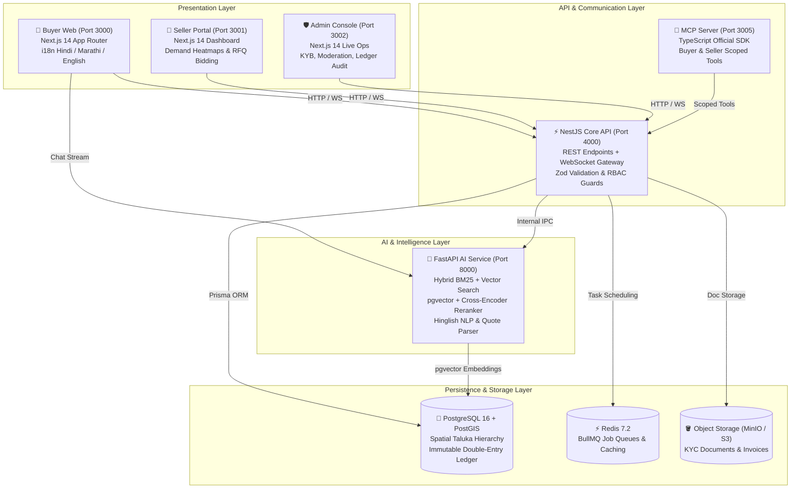

# 🚗 GroupDrive (ग्रुपड्राइव)

> **Rural Bharat Collective Car Buying & Reverse-Auction Platform**  
> *Empowering Tier-2, Tier-3, and rural car buyers to pool regional demand into collective cohorts, triggering sealed-bid reverse auctions among certified multi-brand dealerships for guaranteed lowest landed doorstep delivery prices.*

---

[](https://www.typescriptlang.org/)
[](https://nextjs.org/)
[](https://nestjs.com/)
[](https://fastapi.tiangolo.com/)
[](https://www.postgresql.org/)
[](https://www.prisma.io/)
[](https://tailwindcss.com/)
[](https://playwright.dev/)
[](LICENSE)

---

## 📌 Executive Summary

Buying a passenger or commercial vehicle in non-metro India is notoriously opaque. Buyers in rural talukas often pay high dealer handling fees, overpriced mandatory accessory packages, inflated insurance premiums, and arbitrary transport charges without regional leverage.

**GroupDrive transforms rural auto purchasing through 5 core innovations:**

1. **Hyper-Local Demand Aggregation**: Buyers within a geographic radius (Pincode, Taluka, or District cluster) pool demand for identical or complementary car models into timed cohorts.
2. **Sealed-Bid Reverse Auctions (RFQ)**: Upon hitting buyer quorum (e.g., 5 to 25 cars), a 48-hour sealed auction opens exclusively to authorized, KYB-verified dealerships. Dealers submit unalterable, cryptographically sealed quotes with line-item breakdowns.
3. **Normalized Landed Cost Engine**: Every bid is algorithmically normalized to include factory ex-showroom, state-specific RTO taxes, comprehensive zero-dep insurance, mandatory vs. optional accessories, and flat-bed doorstep delivery logistics to the buyer's home taluka.
4. **Democratic Cohort Voting & Deal Locking**: Cohort members review transparent comparison matrices, vote on the winning dealer, pay a refundable ₹10,000 token into an RBI-compliant escrow ledger, and track factory chassis allocation through doorstep delivery.
5. **Multilingual AI Car Advisor**: An enterprise RAG pipeline natively supporting Hindi (हिंदी), Marathi (मराठी), English, and Hinglish with strict guardrails against false financial guarantees.

---

## 🖼️ Application Showcase

| Buyer Experience & Discovery | Multilingual AI Car Advisor |
|:---:|:---:|
|  |  |
| *District demand pooling, cohort quorum tracker, and responsive mobile-first UI* | *Bilingual RAG advisor in Hindi/Marathi/Hinglish with citations and guardrails* |

| Seller Regional Demand & RFQ Quoting | Admin Live Operations & Ledger Audit |
|:---:|:---:|
|  |  |
| *Taluka-level demand heatmap, sealed-bid drafting with Quote-Assist AI, and stock CSV importer* | *Real-time auction telemetry, KYB verification queue, and immutable double-entry ledger* |

---

## ⚡ Quick Start (< 10 Commands)

Get the complete GroupDrive monorepo running locally in under 2 minutes:

```bash
# 1. Clone the repository
git clone https://github.com/groupdrive/groupdrive.git
cd groupdrive

# 2. Install monorepo dependencies
pnpm install

# 3. Boot the local embedded PostgreSQL + PostGIS server
pnpm db:server

# 4. Synchronize database schema and generate Prisma client
pnpm db:push

# 5. Seed full demo dataset (3 states, 10 districts, 8 brands, 100 variants, 15 dealers, 25 cohorts)
pnpm seed:demo

# 6. Build shared libraries, API gateway, and web applications
pnpm build

# 7. Start the development server (Buyer Web, Seller Web, Admin Web, API, and AI Service)
pnpm dev

# 8. Run the end-to-end smoke test suite to verify all 17 microservice health checks
pnpm smoke
```

Once running, navigate to:
- **Buyer Web Application**: [http://localhost:3000](http://localhost:3000)
- **Seller Dealer Portal**: [http://localhost:3001](http://localhost:3001)
- **Admin Control Room**: [http://localhost:3002](http://localhost:3002)
- **NestJS API Core Gateway**: [http://localhost:4000](http://localhost:4000)
- **FastAPI AI RAG Service**: [http://127.0.0.1:8000/docs](http://127.0.0.1:8000/docs)
- **Interactive Guided Demo Page**: [http://localhost:3000/demo](http://localhost:3000/demo)

---

## 🏗️ Architecture Overview

GroupDrive is organized as a high-performance **Turborepo** monorepo featuring decoupled frontend portals, a unified enterprise REST/WebSocket backend, an isolated Python RAG microservice, an MCP (Model Context Protocol) server for LLM orchestration, and an immutable double-entry financial accounting ledger.



For comprehensive deep-dives, see:
- 📐 [docs/architecture.md](docs/architecture.md) — C4 context diagrams, RFQ sequence flows, RAG data flows, and deployment topology.
- 🔌 [docs/api.md](docs/api.md) — Complete OpenAPI 3.1 specifications for Buyer, Seller, and Admin interfaces.
- 🗄️ [docs/er.md](docs/er.md) — Relational schema, spatial indexing, BigInt paise constraints, and entity diagrams.
- 🔄 [docs/state-machines.md](docs/state-machines.md) — Formal state machines for Groups, RFQs, Quotes, Bookings, and Settlements.
- 🧠 [docs/ai.md](docs/ai.md) — RAG chunking, hybrid retrieval, cross-encoder reranking, guardrails, and MCP tool architecture.
- 📖 [docs/user-guide.md](docs/user-guide.md) — Persona walkthroughs with high-resolution screenshot flows.
- ⚖️ [docs/limitations.md](docs/limitations.md) — Real vs. simulated components and regulatory go-live roadmap.
- 🚀 [docs/future-work.md](docs/future-work.md) — Phase 2 & Phase 3 product roadmap.

---

## 💻 Tech Stack Matrix

| Layer | Technologies | Rationale & Purpose |
|:---|:---|:---|
| **Frontend Applications** | Next.js 14 (App Router), React 18, TypeScript, Tailwind CSS, Lucide Icons | Server-side rendering, sub-second LCP, zero-runtime CSS, fully responsive from 360px mobile to 4K displays. |
| **State & Data Fetching** | React Server Components, TanStack Query, Zustand | Optimistic mutations, real-time cache invalidation, and lightweight local UI state. |
| **API Gateway** | NestJS 10, Express, `@nestjs/websockets`, Zod | Type-safe REST APIs, real-time WebSocket bidding updates, strict DTO schema validation. |
| **AI & NLP Microservice** | FastAPI, Python 3.11, PyTorch, sentence-transformers, LangChain, LiteLLM | High-concurrency async RAG retrieval, `all-MiniLM-L6-v2` embeddings, and Hinglish entity extraction. |
| **LLM Tool Orchestration** | Model Context Protocol (MCP) TypeScript SDK | Standardized LLM tool calling with strict token role isolation (Buyer cannot see Seller tools). |
| **Primary Database** | PostgreSQL 16 with PostGIS & `pgvector` extensions | Spatial taluka distance clustering, vector similarity search, and ACID transactional integrity. |
| **ORM & Migrations** | Prisma 5.18 | Type-safe query building, zero-cost relation joins, declarative schema migrations. |
| **Cache & Task Queue** | Redis 7.2, BullMQ | RFQ 48-hour timer evaluation, sealed-quote auto-unsealing, asynchronous notification dispatches. |
| **Testing & Quality** | Vitest, Playwright, Axe-Core, K6 | Unit and integration test coverage, golden-path E2E browser flows, WCAG 2.1 AA accessibility checks. |
| **DevOps & Containers** | Docker (Multi-stage non-root), Caddy 2.8 Reverse Proxy, GitHub Actions | Zero-downtime TLS termination, automatic gzip/zstd compression, reproducible CI/CD. |

---

## 📁 Repository Map

```
groupdrive/
├── .github/
│   └── workflows/
│       └── deploy.yml              # Automated CI/CD pipeline (Lint, Test, Migrate, Deploy)
├── apps/
│   ├── admin-web/                  # Next.js 14 Admin Console (Live Ops, KYB, Moderation, Ledger)
│   ├── ai-service/                 # FastAPI RAG Car Advisor & NLP microservice (Python 3.11)
│   │   ├── app/
│   │   │   ├── advisor/            # Hybrid BM25 + Vector RAG engine with cross-encoder reranker
│   │   │   ├── guardrails/         # PII redaction, prompt-injection defense, legal disclaimers
│   │   │   ├── ingestion/          # PDF/Brochure table-aware chunking pipeline
│   │   │   ├── nlp/                # Hinglish intent parser, quote extractor, toxicity filter
│   │   │   └── eval/               # 50-question golden evaluation harness
│   │   └── Dockerfile              # Multi-stage non-root Python container
│   ├── api/                        # NestJS Core API Gateway (Port 4000)
│   │   ├── src/
│   │   │   ├── admin/              # KYB verification, dealer management, audit logs
│   │   │   ├── auth/               # Phone OTP, JWT tokens, RBAC guards
│   │   │   ├── bookings/           # Token payments, chassis allocation, delivery tracking
│   │   │   ├── catalog/            # Brands, vehicle models, variants, spec tables
│   │   │   ├── groups/             # Cohort demand aggregation, quorum logic, member voting
│   │   │   ├── rfqs/               # Sealed-bid reverse auctions, quote unsealing & normalization
│   │   │   ├── settlement/         # Double-entry ledger settlement & 1% commission calculation
│   │   │   └── zones/              # PostGIS spatial taluka hierarchy & state tax configs
│   │   └── Dockerfile              # Multi-stage non-root Node.js Alpine container
│   ├── buyer-web/                  # Next.js 14 Rural Buyer Web App (i18n Hindi/Marathi/English)
│   ├── mcp-server/                 # Model Context Protocol (MCP) server for LLM agent integration
│   └── seller-web/                 # Next.js 14 Dealer Portal (Regional demand, quote drafting, CSV)
├── deploy/
│   └── caddy/
│       └── Caddyfile               # Production reverse proxy configuration with automatic TLS
├── docs/
│   ├── assets/                     # High-resolution screenshots and UI mockups
│   ├── ai.md                       # Comprehensive RAG & MCP architecture specification
│   ├── api.md                      # Complete OpenAPI 3.1 specification (Buyer, Seller, Admin)
│   ├── architecture.md             # System context, sequence flows, and deployment topology
│   ├── audit.md                    # Quality audit and gap analysis report
│   ├── demo-script.md              # 10-minute guided demo script with click path
│   ├── deploy.md                   # Production deployment manual (Low-cost & AWS-lite)
│   ├── er.md                       # Relational database schema & entity relationship guide
│   ├── future-work.md              # Phase 2 & Phase 3 roadmap (Mobile apps, EV, Agri)
│   ├── landed-cost.md              # Landed on-road pricing formulas & 10 worked examples
│   ├── limitations.md              # Real vs. simulated components & regulatory go-live checklist
│   ├── runbook.md                  # SRE incident response runbook (DB, Redis, Payments, AI)
│   ├── security-review.md          # OWASP Top 10 & ASVS Level 2 security audit
│   └── user-guide.md               # Visual end-to-end user guide for Buyers, Sellers, Admins
├── packages/
│   ├── db/                         # Prisma schema, migrations, PGlite server, seed scripts
│   ├── shared/                     # Shared TypeScript interfaces, DTOs, Zod schemas, constants
│   └── ui/                         # Reusable Tailwind UI components (Buttons, Modals, Badges)
├── scripts/
│   ├── db-backup.ts                # SHA-256 verified streaming database backup utility
│   ├── db-restore.ts               # Transactional database restore utility with validation
│   ├── reconcile.ts                # Double-entry ledger audit script (Debits == Credits invariant)
│   ├── smoke-test.ts               # Automated 17-point end-to-end health check script
│   └── test-backup-restore.ts      # Automated backup and restore round-trip test
├── docker-compose.yml              # Local multi-container development environment
├── docker-compose.prod.yml         # Production single-VM multi-stage deployment stack
├── package.json                    # Workspace root scripts and devDependencies
└── turbo.json                      # Turborepo task pipeline configuration
```

---

## 🎮 Interactive Demo Mode

GroupDrive includes a built-in interactive demo environment with pre-configured accounts and a **Fast-Forward Tool** to simulate multi-day auction lifecycles in seconds:

1. Open [http://localhost:3000/demo](http://localhost:3000/demo) in any modern browser.
2. Choose one of the pre-authenticated profiles:
   - **Buyer Persona**: Vikram Patil (Satara Taluka, Maharashtra) — browse open groups, join a Tata Nexon EV cohort, chat with the bilingual AI advisor.
   - **Seller Persona**: Apex Auto World (Authorised Tata & Mahindra Dealer, Pune) — view taluka demand heatmaps, submit a sealed quote, and import clearance inventory via CSV.
   - **Admin Persona**: Platform Operations Lead — trigger fast-forward timers, review KYB documents, moderate listings, and execute double-entry ledger settlements.
3. For a step-by-step walkthrough, refer to [docs/demo-script.md](docs/demo-script.md).

---

## 🧪 Testing & Verification

The codebase is thoroughly tested across unit, integration, financial invariant, security, and end-to-end browser suites:

```bash
# Run unit & integration test suites across all packages
pnpm test

# Verify double-entry ledger balance invariant (Total Debits == Total Credits)
pnpm reconcile

# Run Playwright Golden Path E2E tests (Buyer joins > RFQ > Bids > Vote > Book > Settle)
pnpm test:e2e

# Run production smoke test against running services
pnpm smoke

# Run high-severity dependency vulnerability audit
pnpm audit
```

---

## 📜 Disclaimer & Licensing

> **Notice**: All vehicle prices, road tax brackets, RTO cess calculations, dealer authorizations, and bank escrow references included in the default demo dataset are for **illustrative demonstration purposes only**. Prior to commercial deployment in India, consult legal, financial, and regulatory advisors regarding RBI Payment Aggregator directives, Section 194-O TDS obligations, and state RTO tax schedules.

Distributed under the **MIT License**. Built with ❤️ for Bharat.
