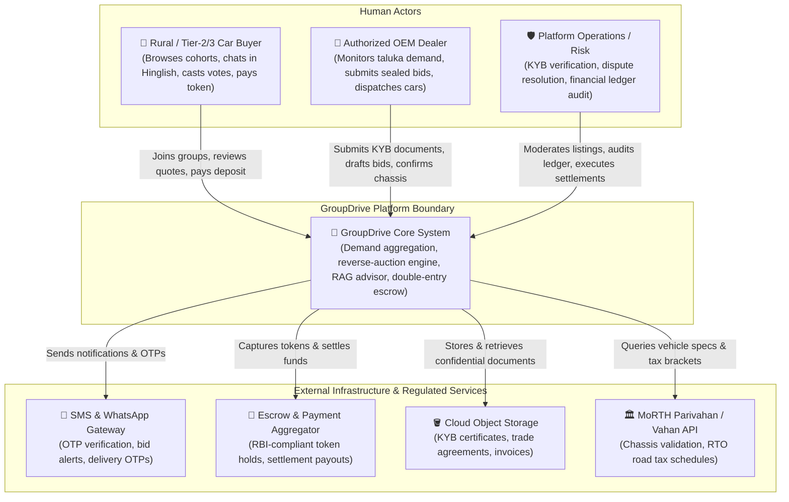
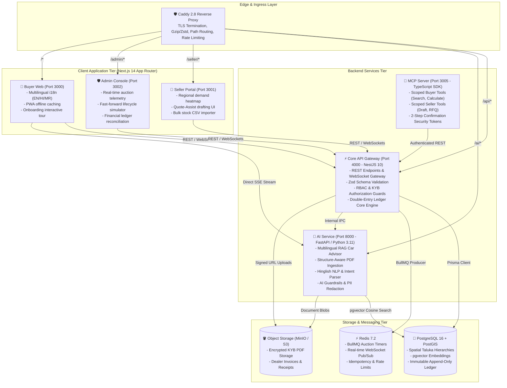
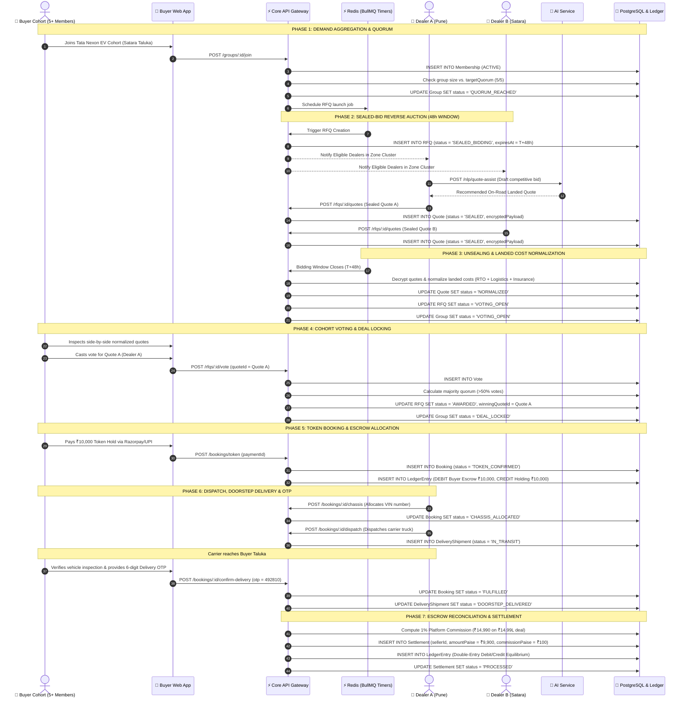
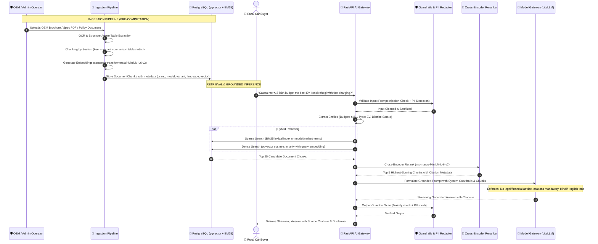
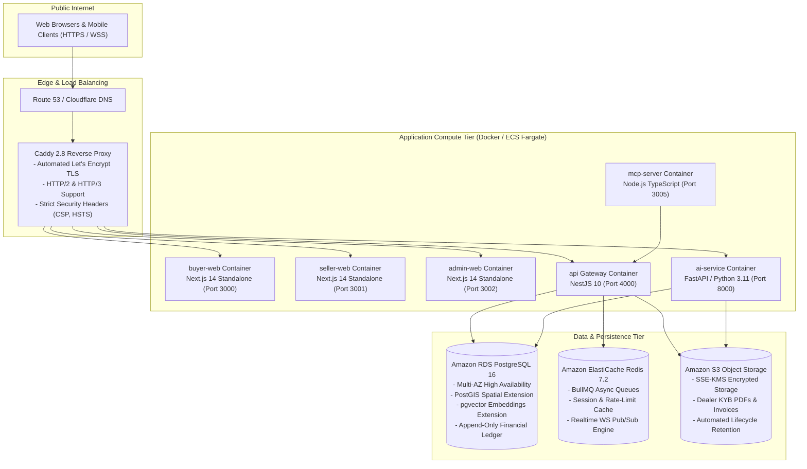

# 🏗️ GroupDrive System Architecture & Technical Specifications

This document outlines the end-to-end technical architecture, system context, service boundaries, lifecycle sequence flows, AI/RAG retrieval pipelines, and deployment topology of the **GroupDrive** platform.

---

## 1. System Context (C4 Level 1)

The system context diagram illustrates how GroupDrive interacts with human actors and external enterprise integrations.

---

## 2. Service Boundaries & Container Architecture (C4 Level 2)

GroupDrive is architected as an event-driven modular microservices suite sharing a unified PostgreSQL transactional database with PostGIS spatial extensions.

---

## 3. Request Flow for the RFQ Lifecycle (Sequence Diagram)

The following sequence details how a buyer group reaches quorum, triggers a competitive sealed-bid reverse auction among dealers, conducts democratic voting, locks the deal, and completes doorstep delivery with double-entry settlement.

---

## 4. Data Flow for the AI / RAG Pipeline (Sequence Diagram)

The AI architecture handles multi-language document ingestion, hybrid sparse-dense retrieval, reranking, and guardrail filtering for Hinglish, Hindi, Marathi, and English user prompts.

---

## 5. Deployment Topology (Production Cloud Architecture)

GroupDrive is engineered for resilient single-VM Docker Compose deployments or enterprise multi-AZ AWS cloud deployments.

---

## 6. Security & Invariant Guarantees

1. **Double-Entry Ledger Equality**: Every debit in `LedgerEntry` has an equal and opposite credit. Balance calculations enforce $\sum \text{Debits} - \sum \text{Credits} = 0$ at all times.
2. **PostgreSQL Immutability Triggers**: `LedgerEntry` and `AuditLog` rows cannot be modified or deleted via SQL commands; any `UPDATE` or `DELETE` attempt raises a database exception.
3. **No Floating-Point Arithmetic**: All monetary quantities are strictly represented as 64-bit integer paise ($1\text{ INR} = 100\text{ paise}$).
4. **Role Isolation**: Buyer tokens cannot execute Seller or Admin actions; Seller tokens cannot access other dealers' bids; sealed bids remain encrypted until the 48-hour auction timer expires.
5. **AI Safety & Disclaimers**: The AI Car Advisor is strictly prohibited from offering binding financing quotes or legal warranties, automatically attaching statutory disclaimers to all pricing outputs.
