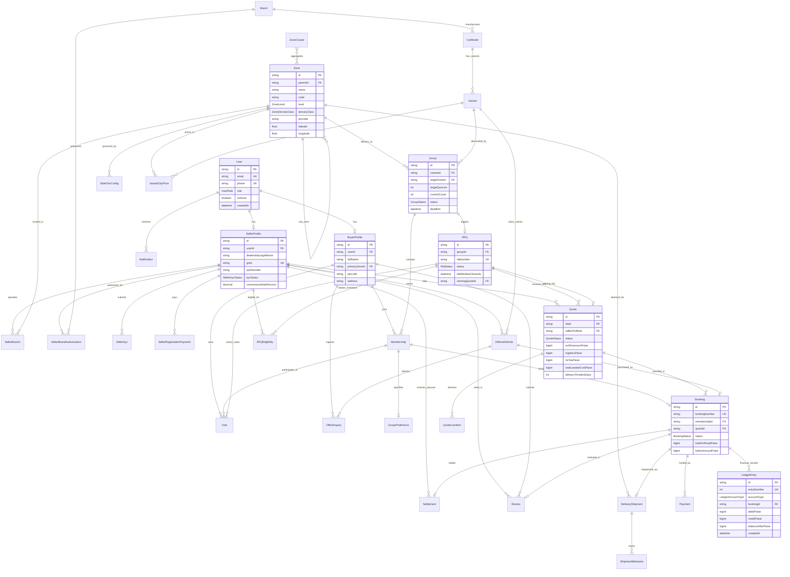

# 🗄️ GroupDrive Database Architecture & Entity-Relationship (ER) Documentation

This document provides the definitive database schema specification for **GroupDrive**, documenting all 33 Prisma models, foreign key relationships, geospatial PostGIS indices, monetary constraints, and double-entry ledger triggers.

---

## 1. Domain Overview & Fundamental Invariants

GroupDrive aggregates automotive demand within geographic delivery zones (`State > District > Taluka > Village/Pincode`). When buyer cohorts achieve quorum, a sealed reverse auction (RFQ) opens to authorized dealerships who compete on a normalized landed delivery basis to the buyer's taluka.

### Core Architecture Invariants:
1. **Monetary Integer Arithmetic in Paise**: All monetary amounts (`exShowroomPaise`, `rtoTaxPaise`, `logisticsPaise`, `insurancePaise`, `tokenPaidPaise`, `debitPaise`, `creditPaise`) are stored as 64-bit BigInts (`BigInt` / `Int`). Floating-point arithmetic is strictly prohibited across the entire financial stack to prevent fractional roundoff errors.
2. **Double-Entry Append-Only Accounting**: The `LedgerEntry` table records immutable debits and credits for every rupee entering or leaving the platform escrow. A PostgreSQL trigger aborts any `UPDATE` or `DELETE` query with an unhandled exception.
3. **Geospatial Zone Clustering**: Administrative boundaries are modelled as a recursive hierarchy with spatial latitude/longitude coordinates (`Zone`) and centroid distance clustering (`ZoneCluster`).
4. **Decoupled Tax Configuration**: State RTO slabs, GST cess rates, and Section 194-O TDS rates reside in `StateTaxConfig` tagged with verification flags.
5. **Role-Isolated Identity**: A single `User` entity links to either a `BuyerProfile` or a `SellerProfile` (with KYB compliance).

---

## 2. Complete Entity-Relationship (ER) Diagram



---

## 3. Detailed Data Models & Specifications

### 3.1 Identity & User Profiles

#### `User`
Primary authentication record for Buyers, Dealership Staff, and Platform Admins.
- `id`: UUID Primary Key.
- `phone`: E.164 verified Indian mobile number (`+919876543210`), unique index.
- `email`: Optional email address, unique index.
- `passwordHash`: Argon2id hashed password (nullable for OTP-only accounts).
- `role`: Enum `UserRole` (`BUYER`, `SELLER`, `ADMIN`).
- `isActive`: Boolean flag for account suspension.

#### `BuyerProfile`
Profiles rural car buyers with geographic home base.
- `userId`: Foreign key to `User.id` (1:1, `onDelete: Cascade`).
- `fullName`: Buyer legal name as registered on Aadhaar/PAN.
- `primaryZoneId`: Foreign key to `Zone.id` (representing the buyer's home taluka).
- `pincode`: 6-digit postal code.
- `address`: Detailed village, post office, and taluka street address.

#### `SellerProfile`
Authorized dealership corporate profile.
- `userId`: Foreign key to `User.id` (1:1).
- `dealershipLegalName`: Registered corporate entity name.
- `tradeName`: Showroom banner name (e.g., "Apex Auto World Pune").
- `gstin`: 15-character Goods and Services Tax Identification Number (unique).
- `panNumber`: 10-character corporate PAN.
- `kycStatus`: Enum `SellerKycStatus` (`DRAFT`, `SUBMITTED`, `VERIFIED`, `REJECTED`).
- `commissionRatePercent`: Platform take-rate (default: `1.00%`).

#### `SellerBranch`
Physical showrooms and stockyard distribution points.
- `sellerProfileId`: Foreign key to `SellerProfile.id`.
- `zoneId`: Foreign key to `Zone.id`.
- `latitude` / `longitude`: Spatial coordinates for transit distance calculation.
- `isHeadquarters`: Boolean flag.

---

### 3.2 Geospatial Hierarchy & State Tax Configurations

#### `Zone`
Self-referencing tree representing India's administrative boundaries.
- `id`: UUID Primary Key.
- `parentId`: Self-reference to parent `Zone.id` (`STATE > DISTRICT > TALUKA > VILLAGE_PINCODE`).
- `name`: Local administrative name (e.g., "Satara Taluka", "Pune District").
- `code`: Standard ISO / Census LGD code.
- `level`: Enum `ZoneLevel` (`STATE`, `DISTRICT`, `TALUKA`, `VILLAGE_PINCODE`).
- `densityClass`: Enum `ZoneDensityClass` (`METRO`, `URBAN`, `SEMI_URBAN`, `RURAL`, `DEEP_RURAL`).
- `latitude` / `longitude`: Spatial centroid coordinates.

#### `StateTaxConfig`
Automobile taxation formulas per state jurisdiction.
- `stateCode`: Two-letter state code (`MH`, `KA`, `MP`).
- `fuelType`: `PETROL`, `DIESEL`, `CNG`, `ELECTRIC`, `HYBRID`.
- `roadTaxPercent`: Progressive road tax percentage based on price brackets.
- `fastagFeePaise`: Statutory FASTag fee in integer paise.
- `hypothecationFeePaise`: Bank loan hypothecation endorsement fee.
- `needsVerification`: Boolean flag indicating illustrative vs. audited rates.

---

### 3.3 Vehicle Catalog & Specification Tables

#### `Brand`
Automobile manufacturers (`TATA`, `MAHINDRA`, `HYUNDAI`, `MARUTI_SUZUKI`, `KIA`, `TOYOTA`, `HONDA`, `MG`).

#### `CarModel`
Vehicle model lines (e.g., "Nexon EV", "Scorpio-N", "Brezza", "XUV700").
- `bodyType`: `SUV`, `COMPACT_SUV`, `HATCHBACK`, `SEDAN`, `MUV`, `EV`.

#### `Variant`
Specific trim level and powertrain configuration (e.g., "Nexon EV Fearless Plus 45 LR").
- `fuelType`: `ELECTRIC`, `PETROL`, `DIESEL`, `CNG`, `HYBRID`.
- `transmission`: `MANUAL`, `AUTOMATIC`, `AMT`, `CVT`, `DCT`.
- `batteryCapacityKwh`: Decimal capacity for EVs.
- `seatingCapacity`: Integer seat count.

---

### 3.4 Group Demand Aggregation & Quorum

#### `Group`
Regional buyer cohorts pooling purchasing volume.
- `variantId`: Foreign key to `Variant.id`.
- `targetZoneId`: Foreign key to `Zone.id` (Taluka / District cluster).
- `targetQuorum`: Target buyer count required to trigger reverse auction (e.g., 5 to 25 cars).
- `currentCount`: Real-time count of active members enrolled.
- `status`: Enum `GroupStatus` (`DRAFT`, `FORMING`, `QUORUM_REACHED`, `RFQ_ACTIVE`, `VOTING_OPEN`, `DEAL_LOCKED`, `FULFILLMENT`, `COMPLETED`, `CANCELLED`).
- `deadline`: Cohort enrollment expiration timestamp.

#### `Membership`
Join record linking a buyer to an active group.
- `buyerProfileId`: Foreign key to `BuyerProfile.id`.
- `groupId`: Foreign key to `Group.id`.
- `status`: Enum `MembershipStatus` (`ACTIVE`, `VOTED`, `CONFIRMED`, `WITHDRAWN`, `REFUNDED`).

---

### 3.5 RFQ, Sealed Reverse Auctions & Quotes

#### `RFQ`
The reverse-auction event spawned when a group reaches quorum.
- `groupId`: Foreign key to `Group.id` (1:1).
- `rfqNumber`: Human-readable reference code (`RFQ-2026-MH-0842`).
- `status`: Enum `RfqStatus` (`SEALED_BIDDING`, `EVALUATION`, `VOTING_OPEN`, `AWARDED`, `NO_DEAL`, `CANCELLED`).
- `bidWindowClosesAt`: 48-hour deadline for dealer bids.
- `winningQuoteId`: Foreign key to `Quote.id` once awarded.

#### `Quote`
Dealer bid with itemized cost components.
- `rfqId`: Foreign key to `RFQ.id`.
- `sellerProfileId`: Foreign key to `SellerProfile.id`.
- `status`: Enum `QuoteStatus` (`SEALED`, `UNSEALED`, `NORMALIZED`, `ACCEPTED`, `REJECTED`).
- `exShowroomPaise`: Base vehicle factory invoice in integer paise.
- `logisticsPaise`: Flat-bed freight carrier fee to buyer's taluka.
- `rtoTaxPaise`: State road tax and registration charges.
- `insurancePaise`: 1-year comprehensive + 3-year third-party zero-dep insurance.
- `accessoriesPaise`: Optional/mandatory accessory pack charges.
- `discountPaise`: Volume cohort discount applied by dealer.
- `totalLandedCostPaise`: Net normalized doorstep landed price.
- `deliveryTimelineDays`: Guaranteed delivery commitment in days.

---

### 3.6 Bookings, Doorstep Delivery & Double-Entry Ledger

#### `Booking`
Individual vehicle purchase contract.
- `bookingNumber`: Unique order reference (`BK-2026-00491`).
- `membershipId`: Foreign key to `Membership.id`.
- `quoteId`: Foreign key to `Quote.id`.
- `status`: Enum `BookingStatus` (`TOKEN_CONFIRMED`, `DEALER_ACCEPTED`, `CHASSIS_ALLOCATED`, `INVOICED`, `REGISTRATION_COMPLETE`, `DELIVERY_IN_PROGRESS`, `FULFILLED`, `CANCELLED`).
- `tokenAmountPaise`: Refundable token amount held in escrow (₹10,000 = `1000000` paise).
- `chassisNumberVin`: 17-character factory Vehicle Identification Number.

#### `DeliveryShipment`
Physical transport tracking from showroom to taluka doorstep.
- `bookingId`: Foreign key to `Booking.id` (1:1).
- `destinationZoneId`: Foreign key to `Zone.id`.
- `status`: Enum `DeliveryStatus` (`DISPATCHED`, `IN_TRANSIT`, `ARRIVED_ZONE`, `DOORSTEP_DELIVERED`).
- `carrierName` / `truckRegistrationNumber`: Freight carrier details.
- `deliveryOtp`: 6-digit cryptographic verification code.

#### `LedgerEntry`
The immutable double-entry financial accounting ledger.
- `id`: UUID Primary Key.
- `entryNumber`: Auto-incrementing sequence index.
- `accountType`: Enum `LedgerAccountType` (`BUYER_ESCROW_HOLD`, `PLATFORM_REVENUE`, `SELLER_RECEIVABLE`, `TAX_PAYABLE`).
- `bookingId`: Foreign key to `Booking.id`.
- `debitPaise`: BigInt debited amount in paise.
- `creditPaise`: BigInt credited amount in paise.
- `balanceAfterPaise`: Running account balance in paise.
- `description`: Transaction explanation (e.g., "Token hold capture via Razorpay webhook").

---

## 4. PostgreSQL Triggers & Invariant Protections

### Ledger Immutability Trigger
To guarantee financial integrity and regulatory compliance, direct SQL modifications to the `LedgerEntry` table are prohibited at the database engine level:

```sql
CREATE OR REPLACE FUNCTION prevent_ledger_modification()
RETURNS TRIGGER AS $$
BEGIN
    RAISE EXCEPTION 'Illegal Operation: LedgerEntry records are immutable double-entry records and cannot be updated or deleted. Post an offsetting entry instead.';
END;
$$ LANGUAGE plpgsql;

CREATE TRIGGER trigger_ledger_entry_immutable
BEFORE UPDATE OR DELETE ON "LedgerEntry"
FOR EACH ROW EXECUTE FUNCTION prevent_ledger_modification();
```
