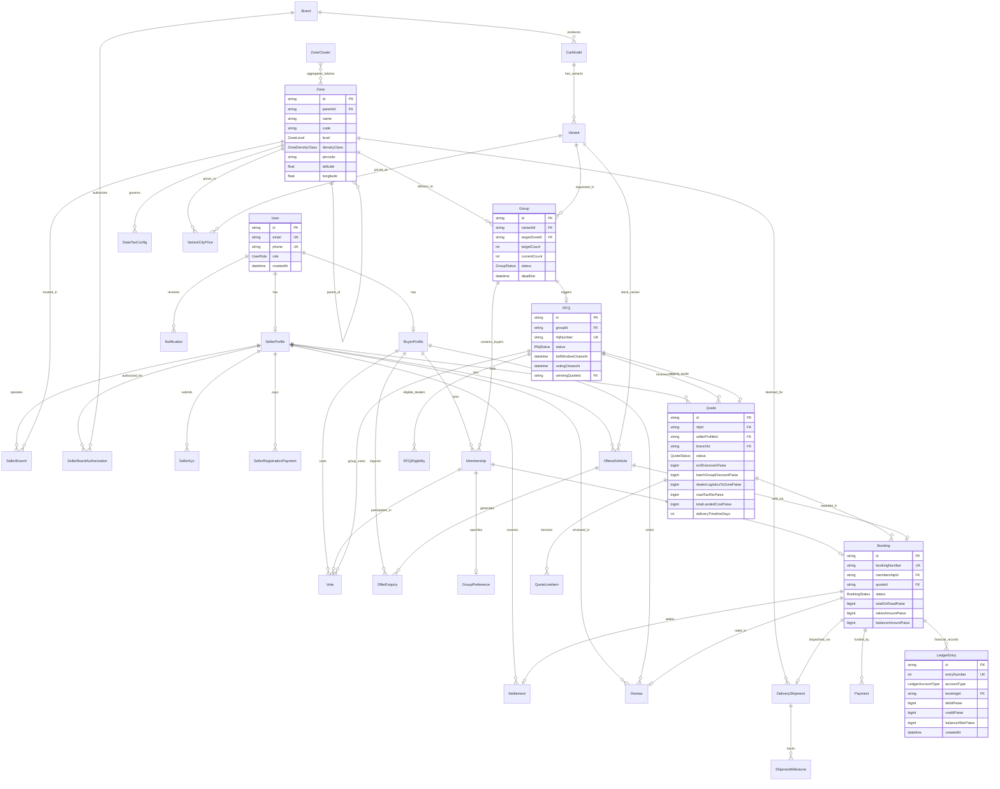

# GroupDrive — Database Architecture & Entity-Relationship (ER) Documentation

---

## 1. Domain Overview & Invariants
GroupDrive is an Indian rural-first, group car-buying marketplace. Demand is aggregated within geographic delivery zones (`State > District > Taluka > Village/Pincode`). When buyer cohorts reach quorum, a sealed reverse auction (RFQ) opens to verified multi-brand dealerships across India, who quote strictly on a **normalized landed delivery basis** to the buyer's taluka.

### Core Data Invariants:
1. **Money Stored in Integer Paise**: All monetary fields (`exShowroomPaise`, `roadTaxRtoPaise`, `tokenPaidPaise`, `amountPaise`, etc.) are 64-bit BigInts. Floats are never used.
2. **Immutable Append-Only Ledger**: The `LedgerEntry` table records double-entry bookkeeping for buyer tokens, platform commission (1%), and seller receivables. A PostgreSQL trigger throws an exception on any `UPDATE` or `DELETE`.
3. **Zone Centroid Spatial Topology**: Administrative hierarchy is modelled as a self-referencing tree with spatial coordinates (`latitude`, `longitude`) and density classifications (`METRO`, `URBAN`, `SEMI_URBAN`, `RURAL`, `DEEP_RURAL`).
4. **Audit Logging**: Every state change, KYC approval, and financial transaction creates an immutable row in `AuditLog`.
5. **Decoupled Tax Configuration**: Road tax (RTO), GST (28% + cess), and TCS (1% > ₹10L) live in `StateTaxConfig` marked with `needsVerification: Boolean @default(true)`.

---

## 2. Complete Entity-Relationship (ER) Diagram

---

## 3. Explicit State Machines Documentation

### A. Group Status Lifecycle (`GroupStatus`)
Enforces the lifecycle of buyer demand aggregation within a rural taluka:
- `DRAFT`: Initial group creation pending confirmation from the initiator.
- `FORMING`: Group is published and accepting buyers in the target zone (e.g. 1/5 buyers joined).
- `QUORUM_REACHED`: Group threshold reached (e.g. 5/5 buyers). Reverse auction trigger initiated.
- `RFQ_ACTIVE`: Sealed bidding window opened for authorized dealers.
- `VOTING_OPEN`: Sealed bidding closed; normalized quotes published for buyer cohort voting.
- `DEAL_LOCKED`: Winning quote voted by majority; buyers locked into fulfillment contract.
- `FULFILLMENT`: Dealer accepting individual bookings and dispatching vehicles.
- `COMPLETED`: All vehicles delivered to buyer doorstep; group closed.
- `CANCELLED`: Dissolved due to deadline expiration without quorum or dealer force majeure.

### B. Reverse Auction Status (`RfqStatus`)
Governs the dealer reverse bidding window:
- `SEALED_BIDDING`: Qualified dealers submit blind quotes. Quotes cannot be viewed by competitors or buyers.
- `EVALUATION`: Bid submission window closed. Landed cost calculation engine normalizes all bids.
- `VOTING_OPEN`: Normalized quotes presented to the group cohort with 48-hour voting timer.
- `AWARDED`: Highest voted quote is officially awarded the batch contract.
- `NO_DEAL`: No quotes met reserve price or deadline expired without consensus vote.
- `CANCELLED`: Cancelled due to group dissolution.

### C. Dealer Quote Status (`QuoteStatus`)
- `SEALED`: Stored encrypted/sealed during active bidding.
- `UNSEALED`: Opened automatically upon bid window closure.
- `NORMALIZED`: Evaluated by landed cost formula (Ex-Showroom + RTO + Transit + Fastag + TCS - Discount).
- `ACCEPTED`: Selected as the winning deal by group vote.
- `REJECTED`: Outbid or rejected by group vote.

### D. Booking & Delivery Status (`BookingStatus`)
Controls individual car fulfillment:
- `TOKEN_CONFIRMED`: Buyer pledged hold token (₹5,000) via payment gateway.
- `DEALER_ACCEPTED`: Dealer counter-signed order and accepted delivery commitment.
- `CHASSIS_ALLOCATED`: Specific VIN/Chassis allocated by dealer.
- `INVOICED`: RTO registration file prepped and invoice generated.
- `REGISTRATION_COMPLETE`: Permanent State RTO registration & number plate affixed.
- `DELIVERY_IN_PROGRESS`: Vehicle loaded on car-carrier/transit to buyer's taluka.
- `FULFILLED`: Customer physical handover confirmed at doorstep.
- `CANCELLED`: Refunded / cancelled prior to chassis allocation.

### E. Seller KYB Status (`SellerKycStatus`)
- `DRAFT`: Dealership registered credentials.
- `SUBMITTED`: GSTIN, PAN, and OEM authorization documents uploaded.
- `VERIFIED`: Admin reviewed and approved verification documents.
- `REJECTED`: Documents invalid (reason documented); resubmission required.

---

## 4. Ledger Immutability Invariant
The `LedgerEntry` table represents the immutable financial ledger. Under no circumstances may rows in this table be updated or removed. All adjustments must be applied as new offsetting entries (`debitPaise` / `creditPaise`).
A PostgreSQL database trigger `trigger_ledger_entry_immutable` executes before any `UPDATE` or `DELETE` statement and raises an exception:
`'Illegal Operation: LedgerEntry records are immutable and cannot be updated.'`
