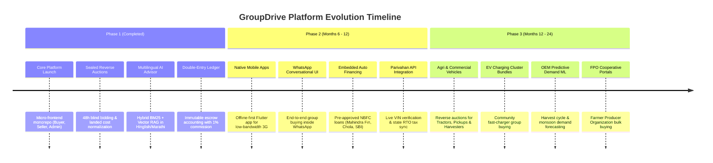

# 🚀 GroupDrive Product Roadmap & Future Architecture (Phase 2 & Phase 3)

This document outlines the strategic product vision, architectural evolution, and multi-year engineering roadmap for **GroupDrive**, detailing the transition from the core MVP into an all-India rural automotive ecosystem.

---

## 1. Multi-Year Vision & Phase Overview



---

## 2. Phase 2: Vernacular Mobile & Embedded Auto Finance (Months 6 – 12)

Phase 2 focuses on deepening accessibility across rural Bharat and eliminating financing friction.

### 2.1 Native Mobile Applications (Flutter / Kotlin Multiplatform)
While the current Next.js 14 PWA is responsive, rural buyers frequently face intermittent network connectivity, high device latency, and background sync limitations:
- **Offline-First Synchronization**: Cache open cohorts and vehicle brochures locally using SQLite / Drift. Users can browse, bookmark, and draft preference forms without an active cellular connection; state syncs automatically upon signal recovery.
- **Micro-APK Size**: Strict binary budget ($< 15\text{ MB}$) optimized for low-cost Android smartphones with limited storage.
- **Biometric Authentication**: Fingerprint and Android BiometricPrompt authentication replacing SMS OTPs on returning devices.

---

### 2.2 Conversational WhatsApp Bot Commerce
Over 500 million Indians actively use WhatsApp as their primary digital interface. Phase 2 introduces end-to-end conversational buying without requiring an app download:
- **WhatsApp Cloud API Integration**: Powered by Meta Business Solution Providers (e.g., Gupshup, Twilio).
- **Interactive Chat Flows**:
  - *"Satara me Tata Nexon ka group dhundo"* -> Bot sends interactive list of active cohorts.
  - One-click button to cast democratic quote votes directly within WhatsApp messages.
  - Instant PDF delivery receipts and live carrier truck GPS location pins.
- **Voice Note Parsing**: Whisper API integration to transcribe colloquial Hindi/Marathi voice queries into structured group search filters.

---

### 2.3 Embedded Auto Loans & Rural NBFC Aggregation
Passenger vehicle purchases in non-metro India are over 85% debt-financed. Phase 2 integrates digital loan origination directly into the deal-locking step:
- **Lender Partnerships**: Integration with rural-focused Non-Banking Financial Companies (NBFCs) and public sector banks:
  - Mahindra & Mahindra Financial Services (MMFSL)
  - Cholamandalam Investment and Finance Company
  - Shriram Finance
  - State Bank of India (SBI Auto Loan API)
- **Zero-Friction In-App Sanctions**:
  - Soft credit inquiry using PAN and mobile number (CIBIL / Experian pull).
  - Instant conditional loan sanction letters issued in under 3 minutes.
  - Automated EMI comparison matrix shown alongside dealer reverse-auction bids.

---

### 2.4 Automotive Ministry Integrations (Vahan 4.0 & Sarathi)
- **Live G2B Gateway Integration**: Direct integration with National Informatics Centre (NIC) Vahan 4.0 web services.
- **Chassis Allotment Protection**: When a dealer inputs a 17-character VIN, the platform automatically validates that the vehicle is unencumbered, matches the requested trim/color, and is registered to the quoting dealership.
- **Dynamic State Road Tax Calculation**: Real-time road tax calculations directly from state RTO servers, removing the need for manual tax schedule audits.

---

## 3. Phase 3: Rural Mobility & Agricultural Ecosystem (Months 12 – 24)

Phase 3 expands the reverse-auction model beyond consumer cars into commercial utility, agricultural machinery, and green energy infrastructure.

### 3.1 Commercial & Agricultural Equipment Cohorts
Rural economies depend heavily on commercial transport and agricultural mechanization:
- **Tractor Reverse Auctions**: Demand pooling for 40–60 HP tractors (Mahindra, Swaraj, Sonalika, John Deere) across farming talukas.
- **Commercial Small Vehicles**: Bulk buying for light commercial vehicles (LCVs) such as Tata Ace Gold, Mahindra Bolero Maxi Truck, and Ashok Leyland Dost for rural transport aggregators.
- **FPO Bulk Syndicates**: Specialized B2B portal allowing Farmer Producer Organizations (FPOs) and Primary Agricultural Credit Societies (PACS) to pool purchases for combine harvesters and farm implements with government subsidy tracking.

---

### 3.2 Electric Vehicle (EV) Community Charging Clusters
EV adoption in rural areas is hindered by the absence of public charging infrastructure:
- **Charging Bundle Auctions**: When a cohort of 10+ electric vehicles is locked in a taluka, the system automatically spawns a complementary reverse auction for a **30 kW / 60 kW DC Dual-Gun Fast Charger** to be installed at a central village hub or cooperative dairy premise.
- **Hardware Integrations**: Partnerships with charging point operators (CPOs) such as Tata Power EZ Charge, Jio-bp, and ChargeZone.

---

### 3.3 OEM Predictive Demand Forecasting Engine
Leveraging accumulated taluka-level purchasing signals to help automotive manufacturers optimize assembly lines and logistics:
- **Agricultural Crop Cycle Modeling**: Correlating vehicle buying surges with Kharif and Rabi harvest payout windows across agricultural districts.
- **Monsoon & Rainfall Indices**: Predicting regional SUV demand based on monsoon rainfall distribution.
- **OEM Enterprise Dashboard**: B2B analytics portal where OEM territory managers can analyze unmet taluka demand and incentivize local dealer networks to submit aggressive reverse-auction discounts.

---

## 4. Technical Architecture Evolution Matrix

| Architectural Dimension | Current Phase 1 (MVP) | Target Phase 2 (Scale) | Target Phase 3 (Ecosystem) |
|:---|:---|:---|:---|
| **Client Platforms** | Next.js 14 Responsive Web (PWA) | Flutter Native Mobile + WhatsApp Bot | Smart TV Showroom Kiosks + FPO B2B Portals |
| **API Architecture** | Modular NestJS REST + WebSockets | Event-Driven Microservices with RabbitMQ | Decentralized Event Mesh (Apache Kafka) |
| **AI RAG Retrieval** | Single-node pgvector + BM25 | Distributed Qdrant / Milvus Cluster | Multimodal Vision RAG (PDI Damage Video Inspection) |
| **Language Coverage** | English, Hindi, Marathi, Hinglish | + Kannada, Telugu, Tamil, Gujarati, Bengali | Full 22 Scheduled Indian Languages with Voice I/O |
| **Financing Stack** | Simulated Cash / External Bank | Embedded NBFC Instant Sanctions | Automated Escrow Loan Disbursal via AA (Account Aggregator) |
| **Logistics Tracking** | Milestone State Machine + OTP | Real-time GPS Carrier Telematics (Delhivery/Rivigo) | Automated Route Optimization & Multi-Car Carrier Pooling |
| **Identity & KYB** | Manual Admin PDF Review Queue | Automated MCA21 & GSTN API Verification | Self-Sovereign Dealer Identity (Polygon ID / W3C DID) |

---

## 5. Engineering Milestones & Release Schedule

```
Month 06: Flutter Native App Beta (Android) launched in Pune & Satara districts.
Month 08: WhatsApp Conversational Bot pilot for group discovery and voting.
Month 10: Embedded Auto Finance integration with first NBFC lending partner.
Month 12: Production integration with MoRTH Vahan 4.0 API for automated VIN checks.
Month 15: Expansion to Karnataka (Belgaum, Hubli) and Madhya Pradesh (Indore, Ujjain).
Month 18: Launch of Commercial & Tractor Reverse-Auction Module.
Month 24: EV Community Charging Cluster Bundling & OEM Predictive Demand ML.
```
