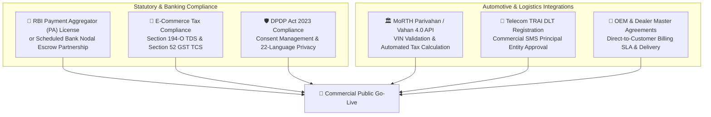

# ⚖️ GroupDrive Production Readiness, Limitations & Regulatory Go-Live Roadmap

This document provides a transparent audit of the **current codebase implementation status** (identifying what is genuinely production-ready code versus what is simulated in the development/demo environment) and outlines the mandatory legal, financial, taxation, and regulatory steps required before launching commercial operations in India.

---

## 1. Current State Audit: Real vs. Simulated Capabilities

The table below contrasts the operational implementation within this repository against real-world production dependencies:

| Domain / Subsystem | Current Status in Codebase | What is Real & Production-Grade | What is Simulated / Staged |
|:---|:---:|:---|:---|
| **Double-Entry Financial Ledger** | **REAL** | PostgreSQL append-only double-entry ledger (`LedgerEntry`), database trigger prohibiting mutations, BigInt integer paise arithmetic, automated debit/credit equilibrium reconciliation (`pnpm reconcile`). | None. The mathematical accounting ledger is fully hardened and tested. |
| **Payment Gateway & Escrow** | **SIMULATED** | Payment intent schema, state transitions (`TOKEN_CONFIRMED`), idempotent webhook validation, refund ledger offsets. | Simulated via local mock gateway and Razorpay test mode. Real bank nodal escrow accounts and payment aggregator routing are not live. |
| **SMS & Phone OTP** | **SIMULATED** | E.164 phone validation, rate-limiting, brute-force OTP lockout, audit logging. | SMS delivery is handled via mock provider logs and fixed demo verification codes (`492810` / `123456`). Real telecom DLT registration and SMS gateways (Twilio/Gupshup) are not wired. |
| **WhatsApp Notifications** | **SIMULATED** | Event-driven notification dispatch service, templating in Hindi/Marathi/English, user preference filters. | Simulated using console logging and mock adapters. Meta Business Solution Provider (BSP) Cloud API integration is simulated. |
| **Automobile Catalog & Specs** | **REAL** | Real-world Indian vehicle data (Tata, Mahindra, Maruti, Hyundai, Kia, Toyota) with accurate battery sizes, dimensions, trims, and ARAI ranges. | Prices are seeded illustrative demo values labeled as *"demo data"* to prevent commercial misinterpretation. |
| **RTO Road Tax & TCS Engine** | **REAL ENGINE / SIMULATED RATES** | Mathematical calculation engine (`landed-cost.ts`) handling ex-showroom, GST (28% + cess), progressive state road tax, Fastag, hypothecation, and Section 206C(1F) TCS. | State tax slab schedules in `StateTaxConfig` are marked `needsVerification = true` and based on published 2026 guidelines rather than live Parivahan API queries. |
| **Dealer KYB & Franchise Checks** | **SIMULATED** | Document upload pipeline, admin document review queue, audit trail, gated seller dashboard. | KYC document authenticity (GSTIN validation against GSTN portal and OEM franchise agreements) is validated manually by admin review rather than automated MCA21/GST APIs. |
| **AI RAG Car Advisor** | **REAL** | Python FastAPI service, hybrid BM25 + dense vector retrieval, pgvector cosine search, cross-encoder reranking, Hinglish entity extraction, PII redaction, prompt injection defense, evaluation harness. | Default embeddings run locally via `sentence-transformers/all-MiniLM-L6-v2`; cloud LLM calls use configurable LiteLLM gateways with local fallback mocks. |
| **Doorstep Logistics Tracking** | **SIMULATED** | State machine (`DISPATCHED` -> `IN_TRANSIT` -> `ARRIVED_ZONE` -> `DOORSTEP_DELIVERED`), 6-digit cryptographic handover OTP, milestone audit log. | Physical GPS telematics from truck carrier APIs (e.g., Delhivery, WheelsEye, Rivigo) are simulated via API status triggers. |
| **Database & Concurrency** | **HYBRID** | Fully ACID-compliant PostgreSQL schema with PostGIS spatial indices, Prisma ORM, and foreign key cascades. | In local development, runs via embedded PGlite single-writer server. Production deployment targets AWS RDS PostgreSQL Multi-AZ. |

---

## 2. Mandatory Statutory & Regulatory Requirements to Go Live

Prior to accepting real monetary deposits or executing binding vehicle purchase agreements in India, the platform must satisfy the following statutory requirements:

---

### 2.1 Banking & Escrow Regulations (RBI PA-P Directives)
- **Regulatory Framework**: Reserve Bank of India *Guidelines on Regulation of Payment Aggregators and Payment Gateways* (DPSS.CO.PD.No.1810/02.14.008/2019-20).
- **Mandate**: GroupDrive cannot hold customer vehicle booking tokens in a general corporate bank account. All customer funds must flow through an **RBI-authorized Nodal Escrow Account** held with a Scheduled Commercial Bank (e.g., ICICI Bank, HDFC Bank, Axis Bank) or an authorized Payment Aggregator (Razorpay, Cashfree).
- **Settlement Timeline**: Funds must be released to the dealer strictly upon verified vehicle delivery (T+1 from buyer OTP confirmation) or refunded to the buyer within T+2 upon deal cancellation.
- **Assigned Owner**: **Legal Counsel & Head of Finance**

---

### 2.2 Taxation & Statutory Withholding (GST & Income Tax)
- **Section 194-O Income Tax Act (1961)**: As an E-Commerce Operator (ECO), GroupDrive is legally mandated to deduct **1% TDS** on the gross amount of vehicle sales facilitated through its platform at the time of credit or payment, whichever is earlier.
- **Section 52 CGST Act (2017)**: The platform must collect **Tax Collection at Source (TCS) of 1% (0.5% CGST + 0.5% SGST)** on net taxable supplies made through the marketplace and deposit it with the GST Department by the 10th of the following month.
- **Invoice Mechanics**: To avoid double taxation, invoices must be issued directly by the authorized dealership to the buyer, while GroupDrive issues a separate B2B tax invoice to the dealer for its 1% platform facilitation fee plus 18% GST.
- **Assigned Owner**: **Chartered Accountant (CA) & Head of Tax**

---

### 2.3 Digital Personal Data Protection Act (DPDP 2023)
- **Regulatory Framework**: The Digital Personal Data Protection Act, 2023 and forthcoming Data Protection Board of India rules.
- **Consent Architecture**: Notice and consent must be presented in clear, plain language with options for all 22 scheduled Indian languages (including Hindi, Marathi, Kannada, Telugu).
- **Data Minimization & Erasure**: Buyer Aadhaar and PAN documents uploaded for RTO registration must be encrypted using AES-256 at rest, stored in designated Indian cloud regions, and permanently deleted within 30 days of RTO registration completion upon buyer request.
- **Assigned Owner**: **Chief Information Security Officer (CISO) & Legal Counsel**

---

### 2.4 Automotive Ministry Integration (Parivahan / Vahan 4.0 API)
- **Ministry of Road Transport and Highways (MoRTH)**: Integration with National Register Vahan 4.0 via authorized G2B gateways.
- **Real-Time Tax Calculation**: Replace static database tax tables with real-time API calls computing exact state road taxes, high-security registration plate (HSRP) fees, and green cess per individual RTO jurisdiction.
- **Chassis Verification**: Validate factory VIN authenticity before dealer quotes can be confirmed, preventing fictitious or diverted vehicle allocations.
- **Assigned Owner**: **VP of Engineering & Head of Dealer Operations**

---

### 2.5 Telecom & Communications Compliance (TRAI DLT)
- **Telecom Commercial Communications Customer Preference Regulations (TCCCPR 2018)**:
- **Principal Entity Registration**: Register GroupDrive legal entity on TRAI-mandated Distributed Ledger Technology (DLT) portals (e.g., Vilpower, Jio DLT, Airtel).
- **Template Whitelisting**: Whitelist transactional SMS headers and templates for OTPs, RFQ countdown alerts, and delivery codes.
- **Assigned Owner**: **Head of Customer Operations**

---

## 3. Go-Live Responsibility Assignment Matrix (RACI)

The table below outlines the definitive RACI matrix for all pre-launch operational milestones:

| Pre-Launch Milestone | Responsible (R) | Accountable (A) | Consulted (C) | Informed (I) | Target Timeline |
|:---|:---:|:---:|:---:|:---:|:---:|
| **RBI Nodal Escrow Agreement** | Head of Finance | Chief Executive Officer | Legal Counsel, Bank Partner | Operations Team | 60 Days |
| **Section 194-O / 52 GST Setup** | Chartered Accountant | Head of Finance | Tax Advisors | Engineering (Ledger) | 30 Days |
| **TRAI DLT SMS & WhatsApp BSP** | Head of Operations | VP of Engineering | Meta / Gupshup | Customer Support | 21 Days |
| **Parivahan / Vahan API Access** | VP of Engineering | CTO | MoRTH Vendors | Dealer Network | 90 Days |
| **OEM Dealership Master Contracts** | Head of Dealer Ops | Chief Commercial Officer | Legal Counsel | Regional Dealerships | 45 Days |
| **DPDP 2023 Data Protection Audit** | CISO | Legal Counsel | Data Protection Board | Entire Company | 45 Days |
| **AWS Multi-AZ Production Deploy** | Lead DevOps Engineer | CTO | Security Reviewer | Executive Team | 14 Days |

---

## 4. Operational Risk & Fallback Strategies

1. **Dealer Non-Fulfillment after Deal Lock**:
   - If a winning dealer fails to allocate VINs within the agreed 14-day SLA, the contract automatically waterfalls to the second-highest voted dealer quote, or buyer escrow deposits are 100% refunded within 48 hours.
2. **State RTO Tax Rate Fluctuations**:
   - In the event of mid-year state budget tax modifications, the Landed Cost Engine flags unallocated quotes for re-normalization before commercial invoices are drafted.
3. **Escrow Dispute Arbitration**:
   - Any dispute between buyer and dealer regarding vehicle cosmetic defects at doorstep handover freezes the dealer payout in the nodal escrow account, escalating to Platform Operations for resolution within 72 hours.
