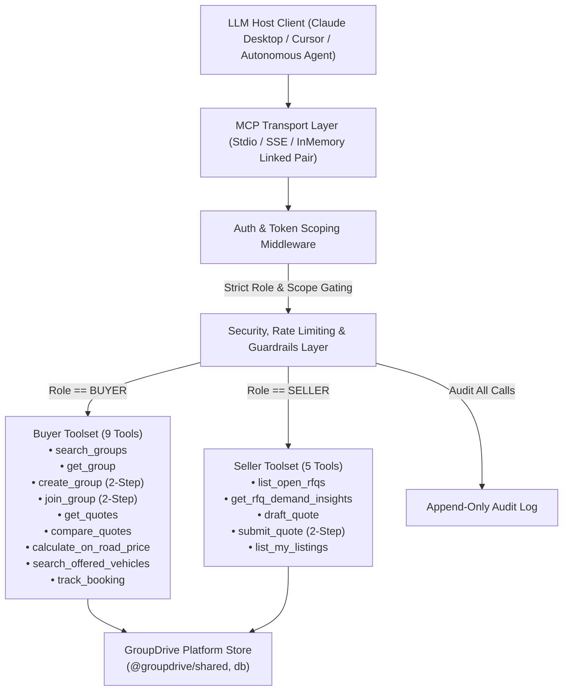
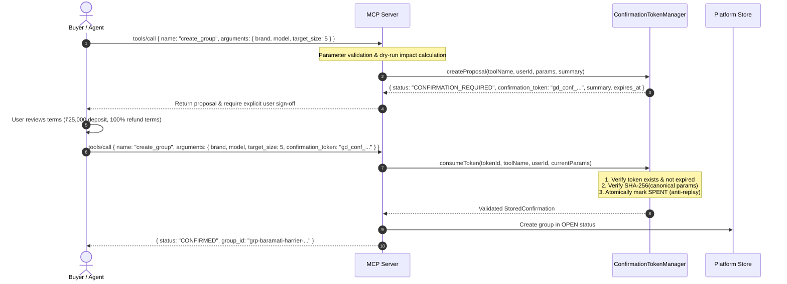

# GroupDrive Model Context Protocol (MCP) Server Specification

The **GroupDrive MCP Server** (`@groupdrive/mcp-server`) exposes the rural-first automotive group buying and sealed reverse auction platform to Large Language Model (LLM) clients such as Claude Desktop, Cursor, OpenAI Agents, and Google Antigravity. Built using the official TypeScript MCP SDK (`@modelcontextprotocol/sdk`), it enforces strict role-based toolset isolation, cryptographic two-step write confirmations, sliding-window rate limits, per-user cost budgets, idempotency keys, prompt-injection sanitization, and immutable audit logging.

---

## 1. Architecture & Protocol Topology



---

## 2. Authentication & Token Scoping

Every MCP session or request is authenticated using a scoped JWT or bearer token passed in the MCP request `_meta` field or session initialization parameters.

### Role & Scope Matrix

| Role | Permitted Scopes | Tool Visibility (`tools/list`) | Unauthorized Access Behavior |
| :--- | :--- | :--- | :--- |
| **`BUYER`** | `buyer:read`, `buyer:write` | **Only 9 Buyer Tools** | Attempting to call any seller tool throws `ForbiddenError` (403). Seller tools are completely omitted from `tools/list`. |
| **`SELLER`** | `seller:read`, `seller:write` | **Only 5 Seller Tools** | Attempting to call any buyer tool throws `ForbiddenError` (403). Buyer tools are completely omitted from `tools/list`. |
| **`ADMIN`** | `admin:read`, `admin:write` | All platform tools + audit | Unrestricted platform operations with mandatory audit trail. |

```typescript
// Example Request with Token Metadata
{
  "jsonrpc": "2.0",
  "method": "tools/call",
  "params": {
    "name": "compare_quotes",
    "arguments": {
      "group_id": "grp-satara-nexon-02",
      "buyer_state": "Maharashtra"
    },
    "_meta": {
      "token": "gd_buyer_8a2d1f99c..."
    }
  }
}
```

---

## 3. Two-Step Write Confirmation Protocol

All destructive, state-mutating, or financial actions (`create_group`, `join_group`, `submit_quote`) strictly require a **two-step cryptographic confirmation flow** to prevent rogue or hallucinated agent executions.



### Security Properties of the Confirmation Token
1. **Replay Prevention**: Once consumed, the token is marked `spent = true`. Any subsequent call with the same token fails with `ConfirmationTokenReplayError`.
2. **Parameter Integrity (SHA-256)**: If an attacker or agent modifies any parameter between proposal and execution (e.g., changes `target_size` from 5 to 3), the hash check fails with `ConfirmationTokenTamperedError`.
3. **Short Expiry Window**: Tokens expire automatically after 5 minutes (`ConfirmationTokenExpiredError`).

---

## 4. Buyer Toolset Specifications

### 1. `search_groups`
Search active taluka/district buyer cohorts.
- **Input Schema**:
  ```json
  {
    "type": "object",
    "properties": {
      "brand": { "type": "string", "description": "Filter by manufacturer brand (e.g. Mahindra, Tata)" },
      "model": { "type": "string", "description": "Filter by model name (e.g. Scorpio-N, Nexon)" },
      "zone_id": { "type": "string", "description": "Geographic delivery zone (e.g. zone-baramati)" },
      "status": { "type": "string", "enum": ["OPEN", "THRESHOLD_MET", "RFQ_OPEN", "QUOTES_CLOSED", "VOTING", "WINNER_SELECTED", "BOOKING", "COMPLETED"] },
      "min_members": { "type": "integer", "minimum": 1 }
    }
  }
  ```
- **Returns**: Matching cohorts with `target_size`, `current_size`, `fill_rate_percent`, and deadline countdown.

### 2. `get_group`
Get detailed cohort state and member variant preferences.
- **Input Schema**:
  ```json
  {
    "type": "object",
    "properties": {
      "group_id": { "type": "string", "description": "Unique ID of the buyer group" }
    },
    "required": ["group_id"]
  }
  ```

### 3. `create_group` *(Two-Step Write)*
Initiate a new local buyer cohort in a taluka/district.
- **Input Schema**:
  ```json
  {
    "type": "object",
    "properties": {
      "brand": { "type": "string" },
      "model": { "type": "string" },
      "variant": { "type": "string" },
      "zone_id": { "type": "string" },
      "target_size": { "type": "integer", "minimum": 3, "maximum": 50 },
      "deadline_days": { "type": "integer", "minimum": 1, "maximum": 30 },
      "color_preference": { "type": "string" },
      "confirmation_token": { "type": "string" },
      "idempotency_key": { "type": "string" }
    },
    "required": ["brand", "model", "variant", "zone_id", "target_size", "deadline_days"]
  }
  ```

### 4. `join_group` *(Two-Step Write)*
Join an active forming cohort with variant and color preference.
- **Input Schema**:
  ```json
  {
    "type": "object",
    "properties": {
      "group_id": { "type": "string" },
      "variant": { "type": "string" },
      "color_preference": { "type": "string" },
      "delivery_zone_id": { "type": "string" },
      "confirmation_token": { "type": "string" },
      "idempotency_key": { "type": "string" }
    },
    "required": ["group_id", "variant", "color_preference", "delivery_zone_id"]
  }
  ```

### 5. `get_quotes`
Fetch received dealer quotes for a group's RFQ.
- **Input Schema**: `group_id: string`
- **Sealed Auction Enforcement**: If the RFQ bidding window is active (`RFQ_OPEN`), quotes remain sealed. Returns `{ bidding_status: "SEALED_BIDDING_ACTIVE", sealed_quotes_received_count: N }`. Unmasks only upon `QUOTES_CLOSED` or `VOTING`.

### 6. `compare_quotes`
Side-by-side comparison using the pure landed-cost engine.
- **Input Schema**: `group_id: string`, `buyer_state?: string`, `selected_quote_ids?: string[]`
- **Computed Outputs**:
  - Ex-showroom base price
  - Reverse auction discount
  - State Road Tax (RTO)
  - Insurance estimate
  - Fastag / statutory cess
  - Doorstep logistics
  - TCS (1% if applicable over ₹10L)
  - Net Landed On-Road Price in paise and INR
  - Total Buyer Savings vs solo showroom MSRP

### 7. `calculate_on_road_price`
Itemized landed cost calculation for any vehicle configuration.
- **Input Schema**: `ex_showroom_paise: number`, `state_code: string`, `fuel_type: string`, `engine_cc?: number`, `is_ev?: boolean`, `logistics_paise?: number`

### 8. `search_offered_vehicles`
Search dealership stock clearance, demo vehicles, and aged stock.
- **Input Schema**: `brand?: string`, `fuel?: string`, `body_type?: string`, `zone_id?: string`, `budget_max_paise?: number`, `category?: string`, `sort_by?: 'discount' | 'price' | 'deal_score'`

### 9. `track_booking`
Track order fulfillment, payment escrow state, and delivery milestones.
- **Input Schema**: `booking_id: string`
- **Returns**: `payment_escrow_status` (`HELD_PENDING_DELIVERY`), 5 shipment milestones, document checklist, and PDI odometer compliance check (< 100 km).

---

## 5. Seller Toolset Specifications

### 1. `list_open_rfqs`
List open reverse auction RFQs matching dealer's brand authorization and delivery territory.
- **Input Schema**: `brand?: string`, `zone_id?: string`

### 2. `get_rfq_demand_insights`
Aggregate buyer demand analytics for an RFQ.
- **Input Schema**: `rfq_id: string`
- **Returns**: Cohort member count, variant distribution, color breakdown, and historical winning discount benchmarks.

### 3. `draft_quote`
Draft a competitive quote and project dealer payout.
- **Input Schema**: `rfq_id: string`, `ex_showroom_discount_paise: number`, `logistics_cost_paise: number`, `free_accessories?: string[]`, `delivery_timeline_days: number`, `validity_hours: number`, `notes?: string`
- **Returns**: Draft quote ID, platform commission calculation (1% + 18% GST), net dealer revenue, and win probability rating.

### 4. `submit_quote` *(Two-Step Write)*
Officially seal and submit a drafted quote into the reverse auction.
- **Input Schema**: `draft_quote_id: string`, `confirmation_token?: string`, `idempotency_key?: string`
- **Requires Two-Step Confirmation**: Prevents unauthorized autonomous commitment without human dealer principal review.

### 5. `list_my_listings`
Manage dealership clearance and aged inventory listings.
- **Input Schema**: `status?: 'ACTIVE' | 'SOLD' | 'PENDING_MODERATION'`

---

## 6. Security & Guardrails

| Guardrail | Mechanism | Threshold / Rule |
| :--- | :--- | :--- |
| **Sliding Window Rate Limiter** | Token bucket tracking in `RateLimiter` | 60 requests per minute per user ID (HTTP 429) |
| **Per-User Cost Budget** | Budget usage tracker in `CostBudgetManager` | $5.00 default allowance per user session (HTTP 402) |
| **Prompt Injection Filter** | Regex scanner & sanitizer in `scanAndSanitizeText` | Detects and neutralizes `ignore previous instructions`, `system prompt override`, `<script>`, etc. |
| **Idempotency Engine** | Composite key cache (`userId::idempotency_key`) | 24-hour TTL; duplicate calls return cached response without duplicate side effects |
| **Immutable Audit Trail** | Append-only logger in `AuditLogger` | Logs `userId`, `role`, `toolName`, `status`, `sanitizedArgs`, and `latencyMs` |

---

## 7. Autonomous Agents

### 1. Buyer Agent (`BuyerAgent`)
- **Mission**: Discovers the best cohort or clearance vehicle matching a buyer's rural criteria (budget, fuel, zone).
- **Behavior**: Scans active groups and compares quotes using the pure landed-cost engine. Explains the exact line-item savings to the buyer and prepares the two-step group join/creation proposal.

### 2. Seller Quote-Assist Agent (`SellerQuoteAssistAgent`)
- **Mission**: Formulates a winning reverse auction bid using demand insights and historical cohort benchmarks.
- **Strict Guardrail**: **NEVER auto-submits bids**. It drafts the quote, evaluates margin payouts, and outputs a step 1 confirmation proposal for human dealership authorization.

### 3. Admin Agent (`AdminAgent`)
- **Mission**: Monitors platform operational integrity and flags anomalies.
- **Anomaly Detection**:
  - **Odometer Fraud**: Deliveries arriving with > 100 km reading trigger an immediate escrow payout freeze.
  - **Unrealistic Pricing**: Stock clearance listings advertising > 30% discount on new stock are flagged for physical Form 22 inspection.
  - **Cluster Expiry Risk**: Forming groups with < 48 hours remaining and < 75% quorum trigger taluka cluster merge recommendations.

---

## 8. Verification & Test Suite Summary

The test suite in `apps/mcp-server/test/` runs 25 automated tests across contract integrity, security, and agent loops:

```bash
pnpm --filter @groupdrive/mcp-server test
```

```
 ✓ test/contract.test.ts (9 tests)
 ✓ test/agents.test.ts (4 tests)
 ✓ test/security.test.ts (12 tests)

 Test Files  3 passed (3)
      Tests  25 passed (25)
   Duration  1.07s
```
