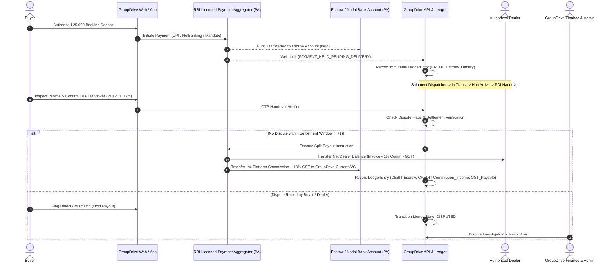

# RBI Nodal Account & Payment Aggregator (PA) Compliance Architecture

**Document Type:** Pre-Production Regulatory & Architecture Specification  
**Status:** REQUIRED TODO BEFORE GO-LIVE  
**Regulatory Framework:** Reserve Bank of India (RBI) Guidelines on Regulation of Payment Aggregators and Payment Gateways (Circular: DPSS.CO.PD.No.1810/02.14.008/2019-20 dated March 17, 2020 and updates).

---

## 1. Statutory Context & Legal Labeling

### 1.1 "Held Pending Delivery" vs. Legal Escrow
- **Current Test Mode Status:**
  On the GroupDrive platform, buyer booking deposits (₹25,000 per vehicle) and seller registration fees (₹19,999 + GST) are labeled strictly as:
  > **"Held Pending Delivery"** / **"Authorized Deposit Held"**
- **Strict Legal Constraint:**
  GroupDrive (the corporate entity) **MUST NOT** claim to operate an independent "Legal Escrow" or hold customer funds directly in an internal current account. Under Indian banking law, accepting third-party funds without an authorized Payment Aggregator (PA) license or a scheduled commercial bank Escrow agreement constitutes illegal deposit-taking under the Banking Regulation Act, 1949.

---

## 2. Target Production Escrow & Settlement Architecture

To transition from test/pre-launch mode to commercial automotive transactions, GroupDrive must execute a tri-party Escrow / Nodal Agreement with an RBI-authorized Scheduled Commercial Bank (e.g., ICICI Bank, HDFC Bank, Axis Bank) or integrate with an RBI-licensed Payment Aggregator (e.g., Razorpay Escrow / Cashfree Verification & Escrow Suite).

---

## 3. Mandatory Regulatory Requirements Before Going Live

### 3.1 Escrow / Nodal Account Mechanics
1. **Nodal Account Mandate:**
   Funds collected from buyers must be credited directly into an Escrow/Nodal account maintained with a scheduled commercial bank. No funds may enter the operating account of the platform.
2. **Permissible Debits from Escrow Account:**
   Under RBI Section 8.2, only the following debits are permitted from the Escrow Account:
   - Payment to dealers/merchants towards settlement of vehicle delivery.
   - Payment of platform commission/convenience fee into GroupDrive's current account (only *after* delivery milestone confirmation).
   - 100% refund to the buyer upon dealer cancellation or order withdrawal.
   - Charges levied by the bank directly related to nodal account operations.

### 3.2 Settlement Timeline (T+1 SLA)
- All confirmed deliveries must settle within **T+1** business days following physical buyer OTP verification.
- In case of dispute, funds must remain frozen in the nodal account until explicit mutual sign-off or administrative dispute resolution order.

### 3.3 Capitalization & Governance Requirements
- Minimum net worth of **₹15 Crore** at the time of application, increasing to **₹25 Crore** by the end of the third financial year (if applying for direct PA authorization).
- Board-approved Customer Grievance Redressal Policy with a designated Nodal Officer and turnaround time (TAT) not exceeding 48 hours for rural consumer complaints.
- System Audit Report (SAR) conducted by a CERT-In empanelled auditor covering all transaction gateways, data residency in India, and encryption key management.

---

## 4. Implementation Checklist for Production Launch

- [ ] Execute tri-party Master Services Agreement (MSA) with partner bank.
- [ ] Implement Razorpay Route / Cashfree AutoCollect API integration for programmatic split settlements.
- [ ] Enforce automated webhook signature verification on all monetary events (`X-Razorpay-Signature`).
- [ ] Connect append-only `LedgerEntry` to daily nodal bank account reconciliation script.
- [ ] Publish statutory RBI-compliant Terms of Service and Escrow Disclosure on buyer checkout pages.
