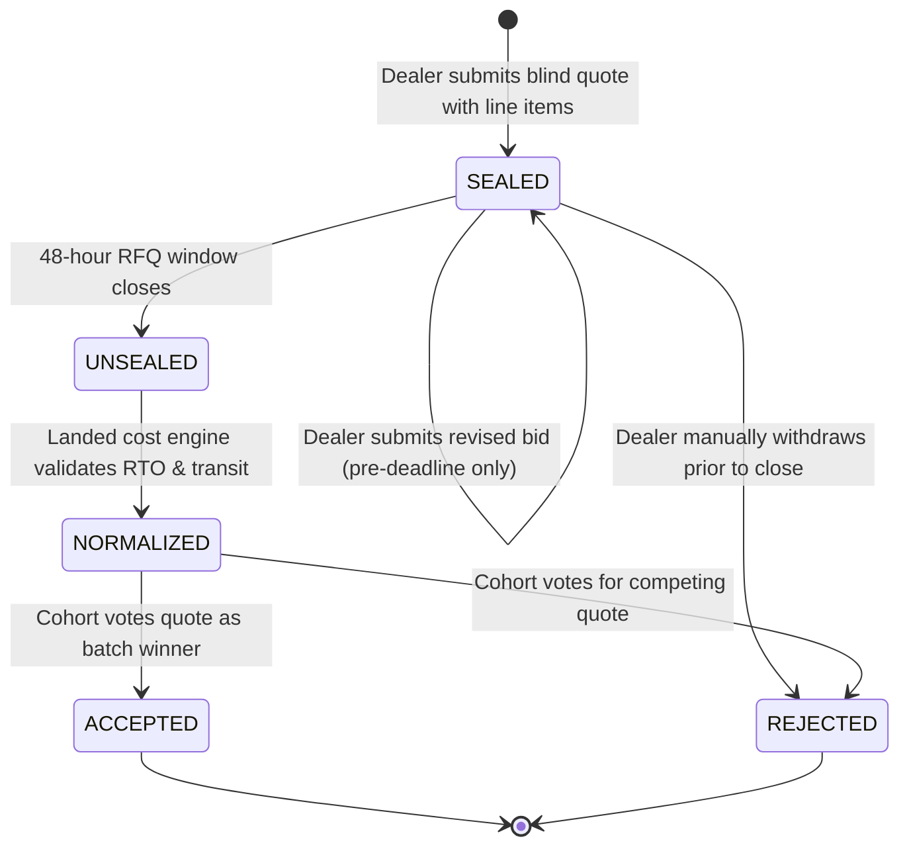
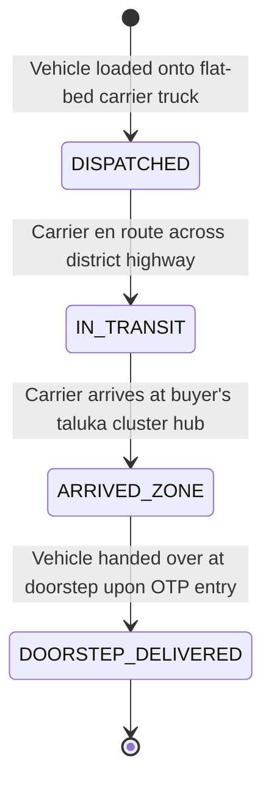

# 🔄 GroupDrive State Machines & Lifecycle Transition Specifications

This document defines the formal finite-state machines (FSM) governing all core domain entities in GroupDrive. All state transitions must adhere strictly to these defined transition paths. Any attempted transition outside these allowed states throws an `IllegalStateTransitionError` and is rejected with an HTTP 400 Bad Request.

---

## 1. Group Demand Aggregation State Machine (`GroupStatus`)

Governs the lifecycle of buyer cohorts forming in a specific taluka/cluster from initial draft to quorum, bidding, voting, fulfillment, and completion.

```mermaid
stateDiagram-v2
    [*] --> DRAFT: Creator initializes cohort
    DRAFT --> FORMING: Published & open for taluka buyers
    DRAFT --> CANCELLED: Creator aborts before publish

    FORMING --> QUORUM_REACHED: Member joins & currentCount >= targetQuorum
    FORMING --> CANCELLED: Deadline expires without reaching quorum or admin abort

    QUORUM_REACHED --> RFQ_ACTIVE: BullMQ worker triggers 48h sealed reverse auction
    QUORUM_REACHED --> FORMING: Member withdraws before RFQ launch (count < target)
    QUORUM_REACHED --> CANCELLED: Admin cancellation / fraud detected

    RFQ_ACTIVE --> VOTING_OPEN: 48h bidding closes; quotes unsealed & normalized
    RFQ_ACTIVE --> CANCELLED: Force majeure / zero eligible dealers

    VOTING_OPEN --> DEAL_LOCKED: Majority (>50%) vote confirms winning dealer quote
    VOTING_OPEN --> RFQ_ACTIVE: Tie-break failure / cohort rejects all quotes (re-auction)
    VOTING_OPEN --> CANCELLED: Cohort abandons vote / deadline passes

    DEAL_LOCKED --> FULFILLMENT: Winning dealer accepts contract; token payments confirmed
    DEAL_LOCKED --> VOTING_OPEN: Winning dealer defaults / fails KYB (fallback to runner-up)
    DEAL_LOCKED --> CANCELLED: Wholesale cohort default

    FULFILLMENT --> COMPLETED: 100% of vehicles delivered with verified OTP handover
    FULFILLMENT --> CANCELLED: Irreparable dealer logistics failure

    COMPLETED --> [*]
    CANCELLED --> [*]
```



### Transition Table: `GroupStatus`

| Current State (`From`) | Allowed Next States (`To`) | Trigger / Guard Condition | Side Effects & Event Dispatches |
|:---|:---|:---|:---|
| `DRAFT` | `FORMING`, `CANCELLED` | Variant & zone validated; initiator sets target quorum (2–50). | Publishes group to regional discovery feed. |
| `FORMING` | `QUORUM_REACHED`, `CANCELLED` | `currentCount >= targetQuorum` triggers `QUORUM_REACHED`. Expiry triggers `CANCELLED`. | Emits `group.quorum_reached` via WebSockets; alerts nearby dealers. |
| `QUORUM_REACHED` | `RFQ_ACTIVE`, `FORMING`, `CANCELLED` | Scheduled reverse-auction job opens sealed bidding. Member withdrawal reverts to `FORMING`. | Spawns corresponding `RFQ` record in `SEALED_BIDDING` status. |
| `RFQ_ACTIVE` | `VOTING_OPEN`, `CANCELLED` | 48-hour bidding window expires. At least 1 valid sealed quote received. | Unseals bids, runs Landed Cost Engine, emits `rfq.bids_opened`. |
| `VOTING_OPEN` | `DEAL_LOCKED`, `RFQ_ACTIVE`, `CANCELLED` | Majority quorum vote (>50%) cast by cohort members. | Awards winning quote, locks pricing contract, requests token hold. |
| `DEAL_LOCKED` | `FULFILLMENT`, `VOTING_OPEN`, `CANCELLED` | Winning dealer acknowledges batch order; buyer token holds captured. | Creates `Booking` records for all members; begins chassis allocation. |
| `FULFILLMENT` | `COMPLETED`, `CANCELLED` | All members complete PDI inspection and provide 6-digit delivery OTP. | Triggers double-entry ledger settlement and 1% platform commission. |
| `COMPLETED` | (None) | Terminal State. | Prompts cohort members for dealer and vehicle reviews. |
| `CANCELLED` | (None) | Terminal State. | Releases all escrow token holds and refunds any charges. |

---

## 2. RFQ & Sealed Bidding State Machine (`RfqStatus`)

Governs the dealer reverse-auction window, quote encryption, normalization, and award.

```mermaid
stateDiagram-v2
    [*] --> SEALED_BIDDING: Group hits quorum; 48-hour timer starts
    SEALED_BIDDING --> EVALUATION: 48-hour clock expires; quotes locked
    SEALED_BIDDING --> CANCELLED: Group cancelled during bidding

    EVALUATION --> VOTING_OPEN: Quotes unsealed; landed costs normalized
    EVALUATION --> NO_DEAL: Zero quotes received after grace period
    EVALUATION --> CANCELLED: Disqualification of all quotes

    VOTING_OPEN --> AWARDED: Cohort selects winning dealer quote
    VOTING_OPEN --> NO_DEAL: Cohort consensus vote rejects all bids
    VOTING_OPEN --> CANCELLED: Group disbanded

    AWARDED --> [*]
    NO_DEAL --> [*]
    CANCELLED --> [*]
```

### Transition Table: `RfqStatus`

| Current State (`From`) | Allowed Next States (`To`) | Trigger / Guard Condition | Side Effects |
|:---|:---|:---|:---|
| `SEALED_BIDDING` | `EVALUATION`, `CANCELLED` | BullMQ worker fires at `bidWindowClosesAt`. | Bidding closed to all dealerships. |
| `EVALUATION` | `VOTING_OPEN`, `NO_DEAL`, `CANCELLED` | Landed cost engine calculates RTO + transit + insurance. If quotes >= 1, `VOTING_OPEN`. | Publishes comparison matrix to cohort. |
| `VOTING_OPEN` | `AWARDED`, `NO_DEAL`, `CANCELLED` | Voting concludes with single winning quote. | Updates `RFQ.winningQuoteId`; sets `QuoteStatus.ACCEPTED`. |
| `AWARDED` | (None) | Terminal State. | Batch awarded to winning dealer. |
| `NO_DEAL` | (None) | Terminal State. | Group initiator notified to re-list or adjust quorum. |
| `CANCELLED` | (None) | Terminal State. | RFQ archived. |

---

## 3. Dealer Quote State Machine (`QuoteStatus`)

Protects quote confidentiality and commercial integrity.



### Transition Table: `QuoteStatus`

| Current State (`From`) | Allowed Next States (`To`) | Trigger / Guard Condition | Description |
|:---|:---|:---|:---|
| `SEALED` | `SEALED`, `UNSEALED`, `REJECTED` | Revision allowed before deadline. Auto-unsealed at window close. | Blind bid encrypted in PostgreSQL. |
| `UNSEALED` | `NORMALIZED` | System verifies line items sum to total. | Line-item costs verified. |
| `NORMALIZED` | `ACCEPTED`, `REJECTED` | Final cohort voting results tally. | Accepted quote forms binding purchase agreement. |
| `ACCEPTED` | (None) | Terminal State. | Generates individual bookings. |
| `REJECTED` | (None) | Terminal State. | Quote archived as unselected bid. |

---

## 4. Individual Booking & Vehicle Fulfillment (`BookingStatus`)

Controls individual car allocation, factory dispatch, and doorstep handover.

```mermaid
stateDiagram-v2
    [*] --> TOKEN_CONFIRMED: Buyer pays ₹10,000 token hold into escrow
    TOKEN_CONFIRMED --> DEALER_ACCEPTED: Dealer signs allotment confirmation
    TOKEN_CONFIRMED --> CANCELLED: Buyer cancels before dealer acceptance (100% refund)

    DEALER_ACCEPTED --> CHASSIS_ALLOCATED: Dealer assigns factory VIN & Engine number
    DEALER_ACCEPTED --> CANCELLED: Dealer unable to supply; token refunded to buyer

    CHASSIS_ALLOCATED --> INVOICED: Commercial tax invoice generated with GST/TCS
    CHASSIS_ALLOCATED --> CANCELLED: VIN failed pre-dispatch inspection (replacement required)

    INVOICED --> REGISTRATION_COMPLETE: State RTO road tax paid; HSRP number plate assigned
    
    REGISTRATION_COMPLETE --> DELIVERY_IN_PROGRESS: Loaded onto flat-bed carrier destined for Taluka
    
    DELIVERY_IN_PROGRESS --> FULFILLED: Buyer inspects vehicle & submits 6-digit Delivery OTP
    DELIVERY_IN_PROGRESS --> CANCELLED: In-transit casualty / carrier accident

    FULFILLED --> [*]
    CANCELLED --> [*]
```



### Transition Table: `BookingStatus`

| Current State (`From`) | Allowed Next States (`To`) | Trigger / Guard Condition | Side Effects |
|:---|:---|:---|:---|
| `TOKEN_CONFIRMED` | `DEALER_ACCEPTED`, `CANCELLED` | Payment gateway webhook verifies ₹10,000 capture. | Creates double-entry escrow hold in `LedgerEntry`. |
| `DEALER_ACCEPTED` | `CHASSIS_ALLOCATED`, `CANCELLED` | Dealer confirms factory production allocation. | Dispatches SMS status update to buyer. |
| `CHASSIS_ALLOCATED` | `INVOICED`, `CANCELLED` | Dealer enters valid 17-character VIN. | Locks VIN to buyer profile. |
| `INVOICED` | `REGISTRATION_COMPLETE` | Tax invoice PDF uploaded with GST line items. | Initiates State RTO tax filing. |
| `REGISTRATION_COMPLETE` | `DELIVERY_IN_PROGRESS` | RTO registration number & HSRP verified. | Creates `DeliveryShipment` in `DISPATCHED` status. |
| `DELIVERY_IN_PROGRESS` | `FULFILLED`, `CANCELLED` | Handover confirmed via buyer delivery OTP. | Releases token hold to dealer settlement ledger. |
| `FULFILLED` | (None) | Terminal State. | Triggers settlement payout calculation. |
| `CANCELLED` | (None) | Terminal State. | Triggers escrow refund workflow. |

---

## 5. Delivery Carrier Tracking (`DeliveryStatus`)

Tracks physical transport of the vehicle from the dealer's regional stockyard to the buyer's taluka doorstep.



---

## 6. Financial Settlement & Dealer Payout (`SettlementStatus`)

Enforces double-entry financial accounting, 1% platform revenue capture, and dealer bank transfer.

```mermaid
stateDiagram-v2
    [*] --> PENDING: Vehicle fulfilled; delivery OTP verified
    PENDING --> PROCESSED: Payout executed; 1% commission deducted; ledger balanced
    PENDING --> DISPUTED: Buyer flags defect / dealer claims deduction dispute

    DISPUTED --> PROCESSED: Admin resolves dispute (releases funds or offsets credit)
    DISPUTED --> PENDING: Dispute resolved in favour of re-inspection

    PROCESSED --> [*]
```



---

## 7. State Invariant Enforcement in Code

1. **Transaction Wrapping**: All state transitions that alter financial, membership, or auction status execute inside a PostgreSQL `prisma.$transaction([...])`.
2. **Transition Guards**: Transition validity is enforced by domain guard functions in `@groupdrive/shared`:
   ```typescript
   export function validateGroupTransition(from: GroupStatus, to: GroupStatus): boolean {
     const allowedTransitions: Record<GroupStatus, GroupStatus[]> = {
       [GroupStatus.DRAFT]: [GroupStatus.FORMING, GroupStatus.CANCELLED],
       [GroupStatus.FORMING]: [GroupStatus.QUORUM_REACHED, GroupStatus.CANCELLED],
       [GroupStatus.QUORUM_REACHED]: [GroupStatus.RFQ_ACTIVE, GroupStatus.FORMING, GroupStatus.CANCELLED],
       [GroupStatus.RFQ_ACTIVE]: [GroupStatus.VOTING_OPEN, GroupStatus.CANCELLED],
       [GroupStatus.VOTING_OPEN]: [GroupStatus.DEAL_LOCKED, GroupStatus.RFQ_ACTIVE, GroupStatus.CANCELLED],
       [GroupStatus.DEAL_LOCKED]: [GroupStatus.FULFILLMENT, GroupStatus.VOTING_OPEN, GroupStatus.CANCELLED],
       [GroupStatus.FULFILLMENT]: [GroupStatus.COMPLETED, GroupStatus.CANCELLED],
       [GroupStatus.COMPLETED]: [],
       [GroupStatus.CANCELLED]: [],
     };
     return allowedTransitions[from]?.includes(to) ?? false;
   }
   ```
3. **Audit Trail**: Every state mutation records an immutable entry in the `AuditLog` table containing `actorType`, `actorId`, `previousState`, `newState`, and timestamp.
