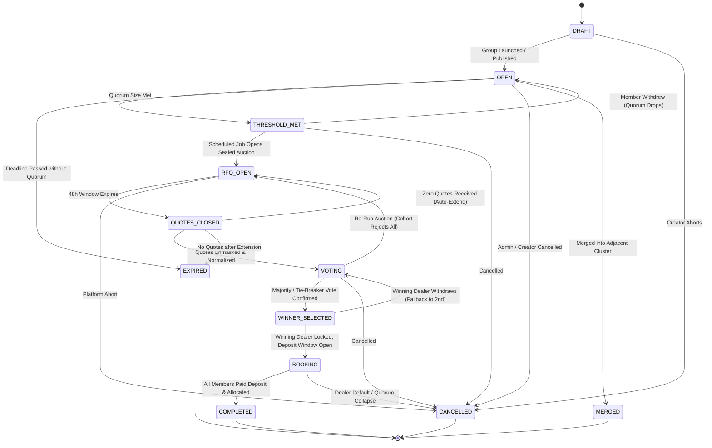
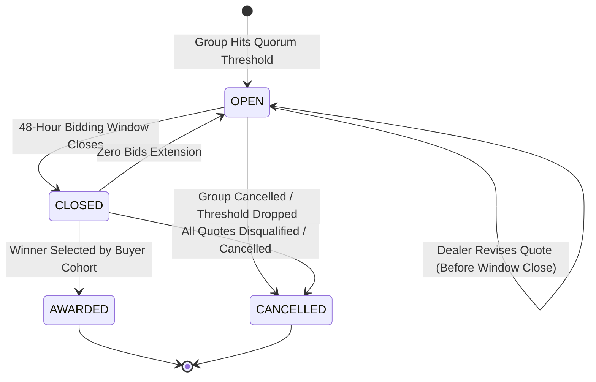
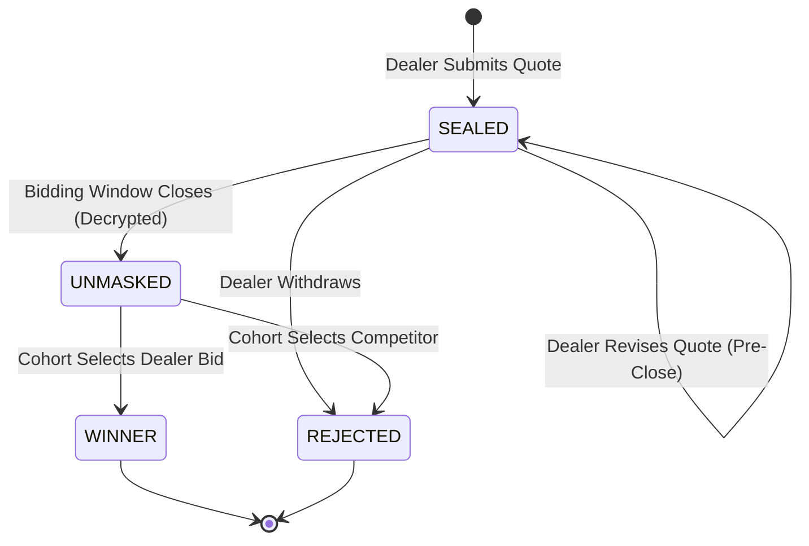
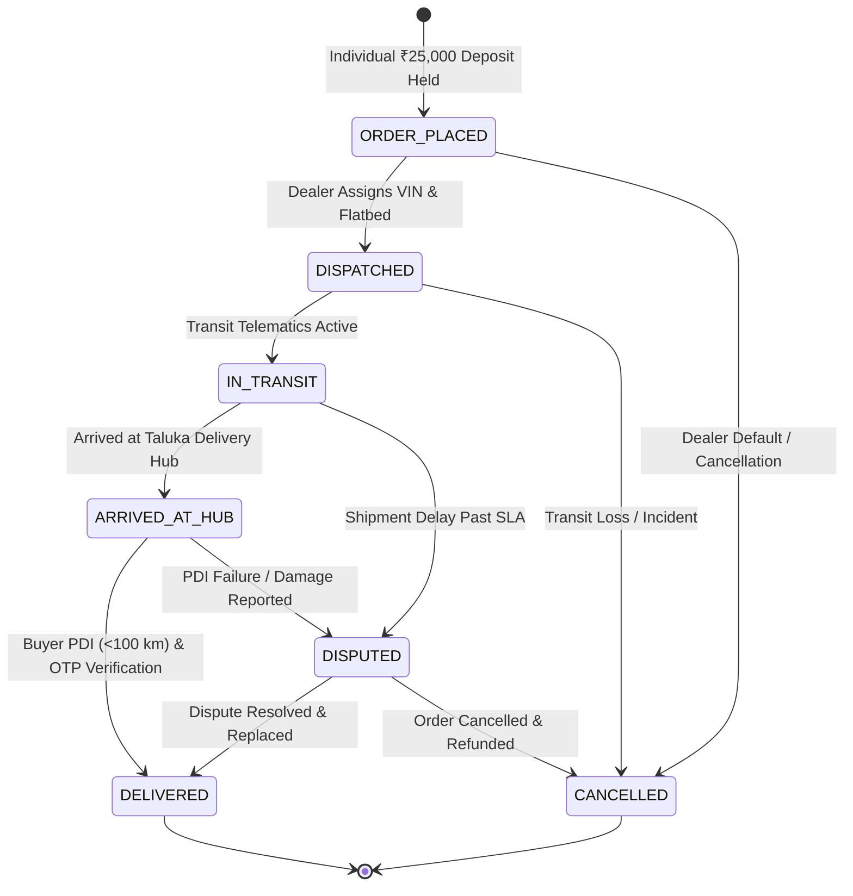
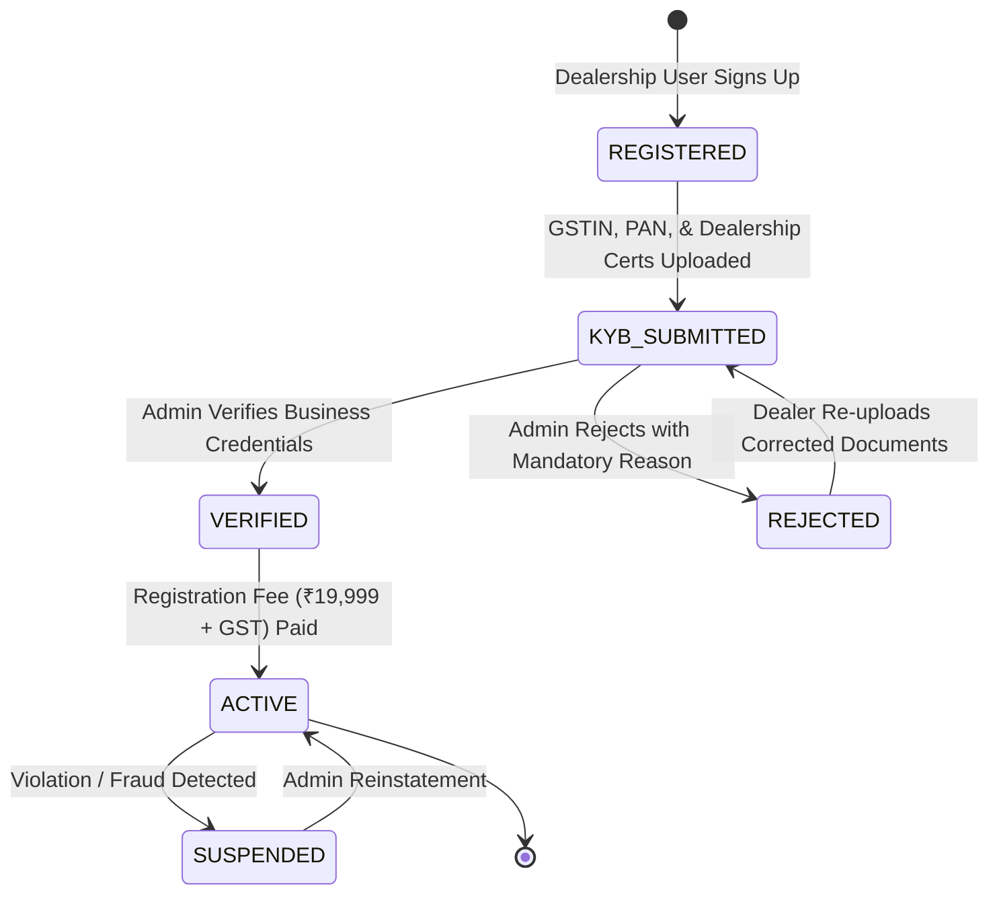
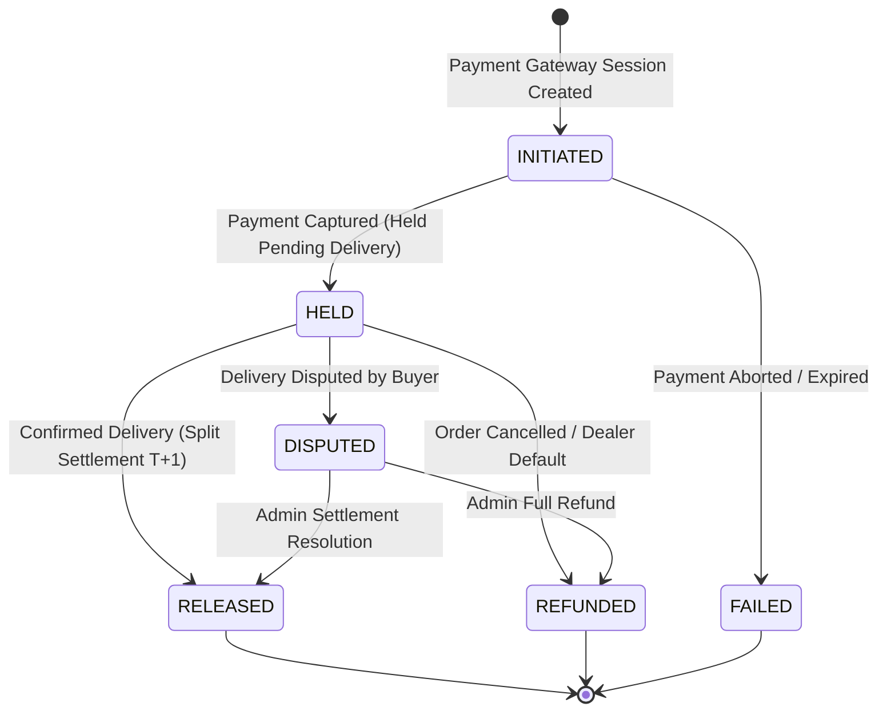

# GroupDrive State Machines Specification & Transition Tables

This document defines the formal finite-state machines (FSM) governing all core domain entities in GroupDrive. All state transitions must adhere strictly to the allowed transition tables. Any attempted transition outside these paths throws an `IllegalStateTransitionError` and is rejected with an HTTP 400 Bad Request.

---

## 1. Group State Machine

Governs the lifecycle of buyer cohorts forming in a specific taluka/cluster.

### Transition Table: Group

| Current State (`From`) | Allowed Next States (`To`) | Trigger / Guard Condition |
| :--- | :--- | :--- |
| `DRAFT` | `OPEN`, `CANCELLED` | Validation of brand, model, target size, and delivery zone. |
| `OPEN` | `THRESHOLD_MET`, `EXPIRED`, `CANCELLED`, `MERGED` | `currentSize >= targetSize` triggers `THRESHOLD_MET`. Deadline triggers `EXPIRED`. Cluster merge triggers `MERGED`. |
| `THRESHOLD_MET` | `RFQ_OPEN`, `OPEN`, `CANCELLED` | Reverse auction engine triggers `RFQ_OPEN`. If a member withdraws before RFQ opens and `currentSize < targetSize`, status drops back to `OPEN`. |
| `RFQ_OPEN` | `QUOTES_CLOSED`, `CANCELLED` | BullMQ scheduled worker evaluates 48-hour bidding deadline. |
| `QUOTES_CLOSED` | `VOTING`, `RFQ_OPEN`, `EXPIRED` | If quotes >= 1, unseal and normalize into `VOTING`. If 0 quotes, extend window or re-run. |
| `VOTING` | `WINNER_SELECTED`, `RFQ_OPEN`, `CANCELLED` | Voting concludes with winning quote chosen. In case of tie, earliest submitted quote wins. |
| `WINNER_SELECTED` | `BOOKING`, `VOTING` | If winning dealer withdraws, fallback to runner-up quote. Otherwise, proceed to `BOOKING`. |
| `BOOKING` | `COMPLETED`, `CANCELLED` | Members complete individual booking deposits. |
| `COMPLETED` | (None) | Terminal state. |
| `EXPIRED` | (None) | Terminal state. |
| `CANCELLED` | (None) | Terminal state. |
| `MERGED` | (None) | Terminal state. |

---

## 2. RFQ & Sealed Bidding State Machine

Governs the dealer reverse-auction window.

---

## 3. Quote State Machine

Governs dealer bids with sealed privacy and cryptographic integrity.

---

## 4. Booking & Shipment Delivery State Machine

Governs individual vehicle procurement, logistics tracking, and handover.

---

## 5. Seller KYB Verification State Machine

Governs dealer onboarding, document verification, and fee payment gating.

---

## 6. Money & Ledger State Machine

Governs all cash movements under the append-only ledger constraint.

