# 📖 GroupDrive User Guide & Role-Based Walkthroughs

Welcome to the **GroupDrive User Guide**. This document provides comprehensive, step-by-step visual walkthroughs for all three platform personas:
1. **Rural & Tier-2/3 Car Buyers** (`apps/buyer-web` - Port 3000)
2. **Authorized Dealerships & Sellers** (`apps/seller-web` - Port 3001)
3. **Platform Operations & Risk Admins** (`apps/admin-web` - Port 3002)

---

## 1. Persona 1: The Rural Buyer Journey

The Buyer Web Application is designed mobile-first, supporting Hindi (हिंदी), Marathi (मराठी), and English with high-contrast UI, low-bandwidth optimization, and an interactive onboarding tour.

---

### Step 1: Onboarding Tour & Value Proposition
Upon first visiting GroupDrive, buyers are greeted with a 3-step interactive onboarding modal explaining how collective demand pooling unlocks wholesale pricing without dealer haggling.

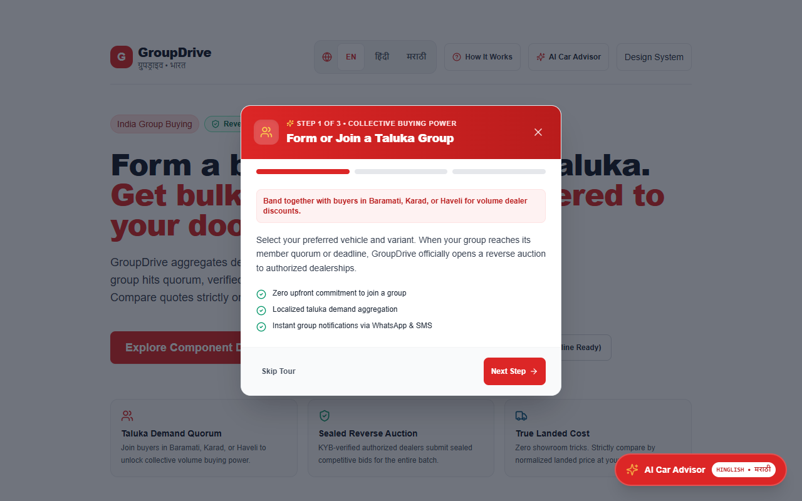

1. **Step 1 — Demand Aggregation**: Buyers in the same taluka or district pool demand for specific car models (e.g., Tata Nexon, Mahindra XUV700, Maruti Brezza).
2. **Step 2 — Sealed Reverse Auction**: When the cohort hits its quorum threshold (e.g., 5 or 10 buyers), certified regional dealers compete blind in a 48-hour auction.
3. **Step 3 — Democratic Choice & Escrow**: The cohort inspects an itemized price breakdown, votes on the best quote, and books with a ₹10,000 refundable escrow deposit.

---

### Step 2: Home Feed & Regional Cohort Discovery
The buyer selects their home district and taluka (e.g., Satara Taluka, Maharashtra) to view active cohorts, current fill counts, and remaining enrollment days.

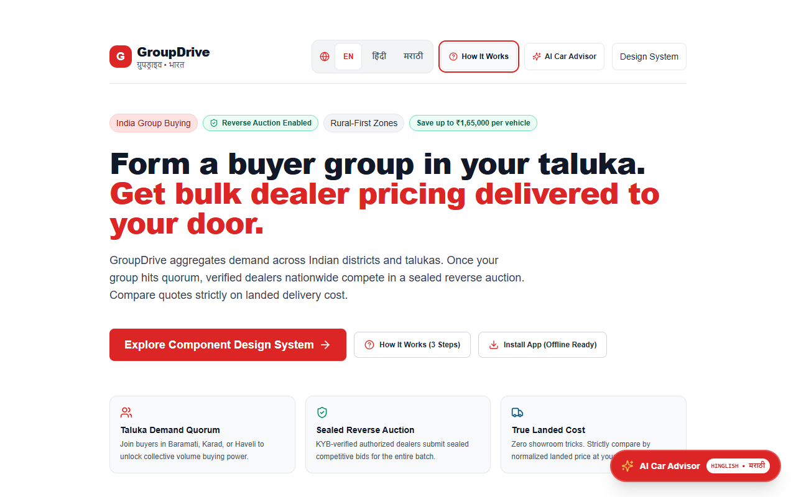

- **Quorum Progress Bar**: Displays real-time progress (e.g., `4 of 5 buyers joined`).
- **Target Vehicle**: Lists exact trim variant, fuel type, transmission, and estimated group discount.
- **Join Button**: One-click cohort enrollment with zero financial commitment until quorum is locked.

---

### Step 3: Consulting the Multilingual AI Car Advisor
Uncertain about whether an electric vehicle or diesel SUV fits their daily driving route? The buyer consults the native AI Car Advisor in conversational Hinglish, Marathi, or Hindi.

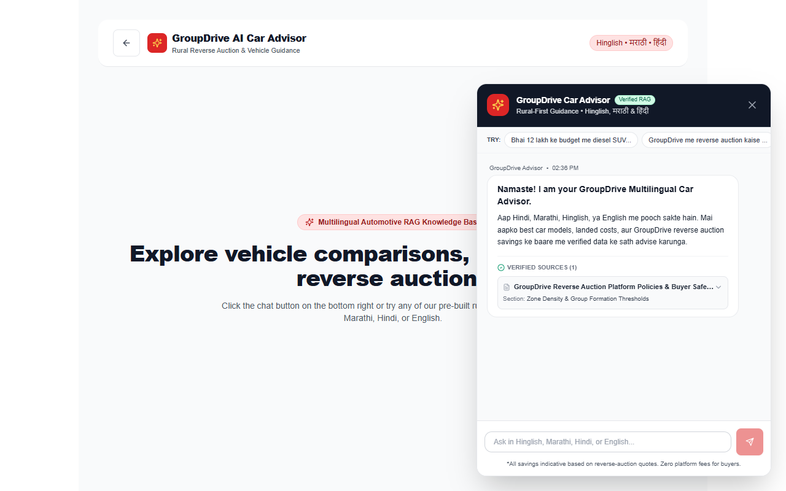

- **Colloquial Queries**: Handles phrases like *"Satara me daily 40km running ke liye konsi EV saste me padegi?"*
- **Structured Citations**: Every answer links directly to verified ARAI range figures, charging times, and state road tax subsidies.
- **Statutory Guardrails**: Strictly flags that on-road estimates are indicative and connects to a human specialist upon request.

---

### Step 4: Quote Comparison & Democratic Voting
Once the 48-hour bidding clock expires, dealer quotes are unsealed, normalized, and displayed side-by-side.

- **Normalized Landed Cost Breakdown**:
  - Base Ex-Showroom price.
  - State RTO road tax and registration charges.
  - 1-Year Comprehensive + 3-Year Zero-Depreciation Insurance.
  - Flat-bed carrier freight delivered to the buyer's taluka doorstep.
  - Transparent dealer cohort discount.
- **Democratic Vote**: Each buyer casts an equal vote. Majority vote wins the batch contract.

---

### Step 5: Booking Deposit, Chassis Allocation & Doorstep Delivery
Once the deal is locked, the buyer finalizes their order:

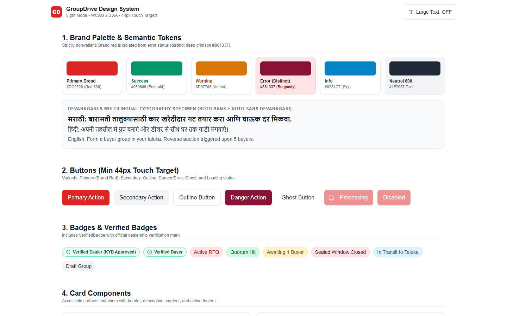

1. **Token Escrow Hold**: The buyer pays a refundable ₹10,000 token into the platform's RBI-compliant nodal escrow account.
2. **Chassis Allocation**: The winning dealer assigns a physical 17-character factory VIN to the order.
3. **Flat-Bed Transit Tracking**: Track the carrier truck as it departs the regional stockyard destined for the buyer's taluka.
4. **Pre-Delivery Inspection (PDI) & OTP Handover**: The buyer inspects the odometer and paint finish, then hands over the 6-digit Delivery OTP to the driver to confirm delivery.

---

## 2. Persona 2: The Dealership Seller Journey

The Seller Portal enables authorized dealerships to capture bulk rural demand, reduce showroom overhead, and clear aged stock inventory through transparent reverse auctions.

---

### Step 1: Dealer KYB Onboarding & Document Verification
To participate in reverse auctions, dealerships must complete Know Your Business (KYB) verification:

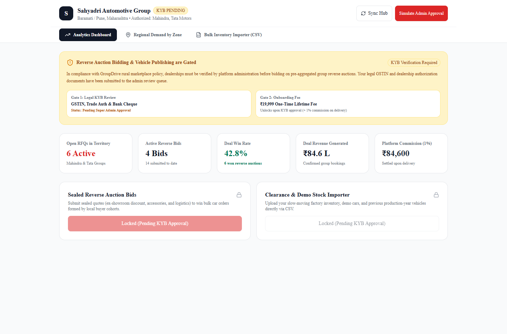

- Submit corporate GSTIN, PAN, and Trade License certificates.
- Upload signed OEM Dealership Franchise Agreements (e.g., Tata Motors, Mahindra).
- Provide cancelled cheque for automated RTGS escrow settlement.
- Once submitted, access remains gated until verified by platform risk officers.

---

### Step 2: Regional Demand Heatmap & Cohort Pipeline
Once verified, the dealer dashboard displays active buyer demand clusters across nearby talukas:

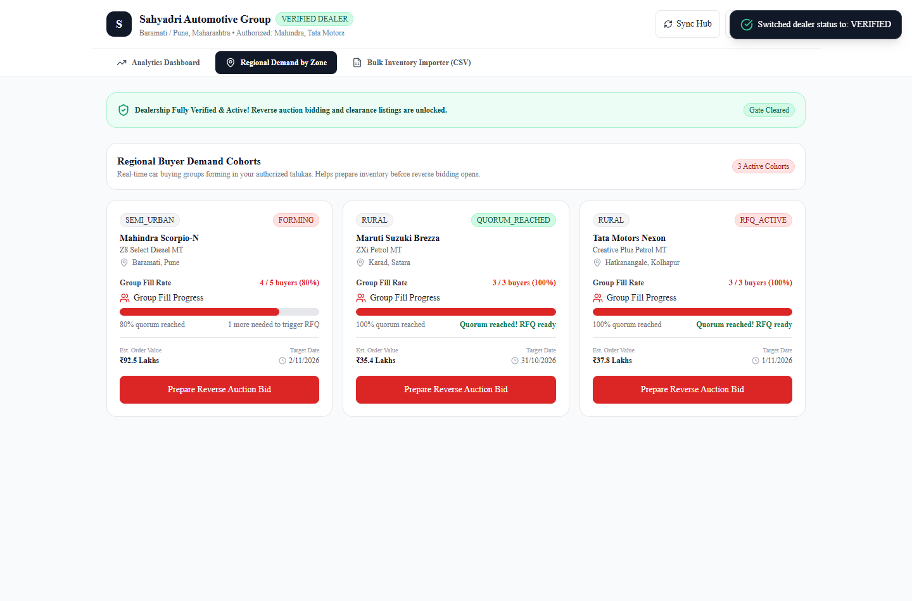

- **Taluka Proximity Heatmap**: Surfaces demand clusters within 50 km, 100 km, and 200 km radii.
- **Conversion Likelihood**: Shows cohorts that are 80%+ filled and about to trigger reverse auctions.
- **Logistics Calculator**: Estimates flat-bed transport freight based on highway kilometers from dealer stockyard to destination taluka.

---

### Step 3: Drafting & Submitting Sealed Bids
When an RFQ opens in the dealer's territory, the dealer drafts a competitive quote:

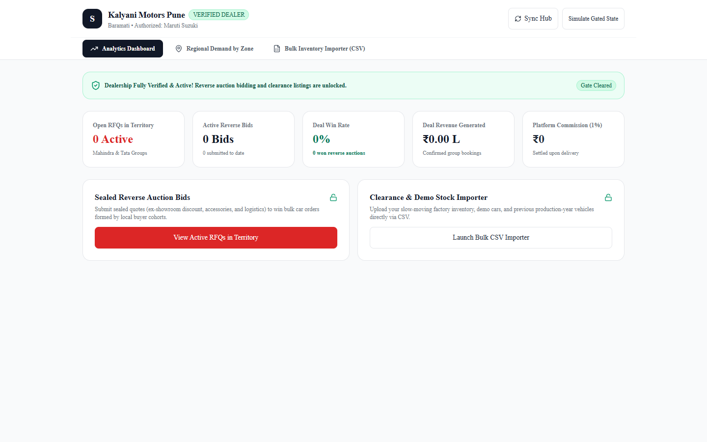

- **Quote-Assist AI**: Recommends an optimal batch discount based on historical winning bids and competitor density.
- **Itemized Transparency**: Dealer inputs base ex-showroom, factory logistics, mandatory RTO taxes, and accessory pack options.
- **Cryptographic Seal**: Once submitted, the bid is sealed in the database. Competitor dealers cannot see each other's quotes until the window closes.

---

### Step 4: Clearance Stock & CSV Bulk Inventory Importer
Dealers can also list aged demo units or year-end clearance vehicles for immediate sale to buyers:

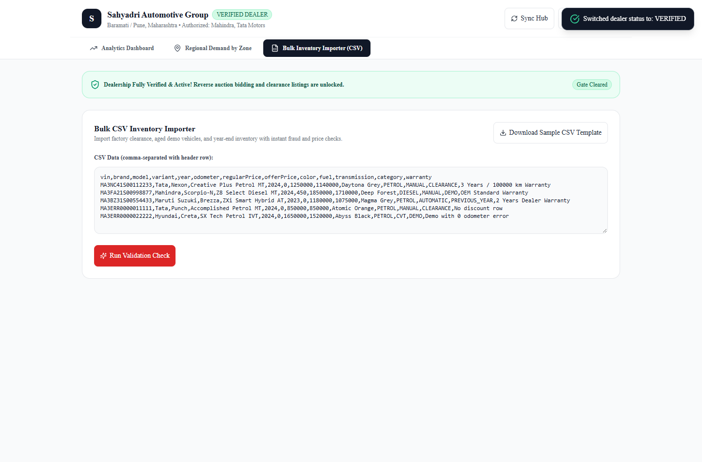

- **CSV Drag-and-Drop**: Upload bulk inventory spreadsheets with VIN, variant codes, model year, and clearance discounts.
- **Validation Engine**: Automatically flags mismatched trim codes or invalid VIN lengths prior to ingestion.

---

## 3. Persona 3: Platform Operations & Risk Admin

The Admin Console provides centralized command and control for operations leads, financial auditors, and dispute specialists.

---

### Step 1: Live Operations Telemetry Control Room
Monitors marketplace throughput, conversion funnels, and active reverse auctions in real-time.

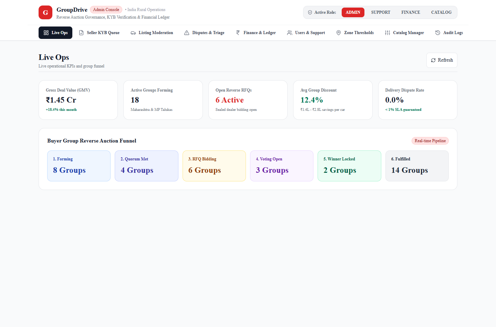

- **Real-Time Counters**: Active buyer cohorts, open RFQs in bidding, and gross merchandise volume (GMV).
- **Geographic Cluster Health**: Identifies talukas with high demand density needing additional dealer authorizations.
- **System Health Gauges**: Latency monitors for PostgreSQL PostGIS, Redis BullMQ, and the FastAPI RAG service.

---

### Step 2: Dealership KYB Verification Queue
Platform compliance officers review dealer credentials before granting bidding privileges.

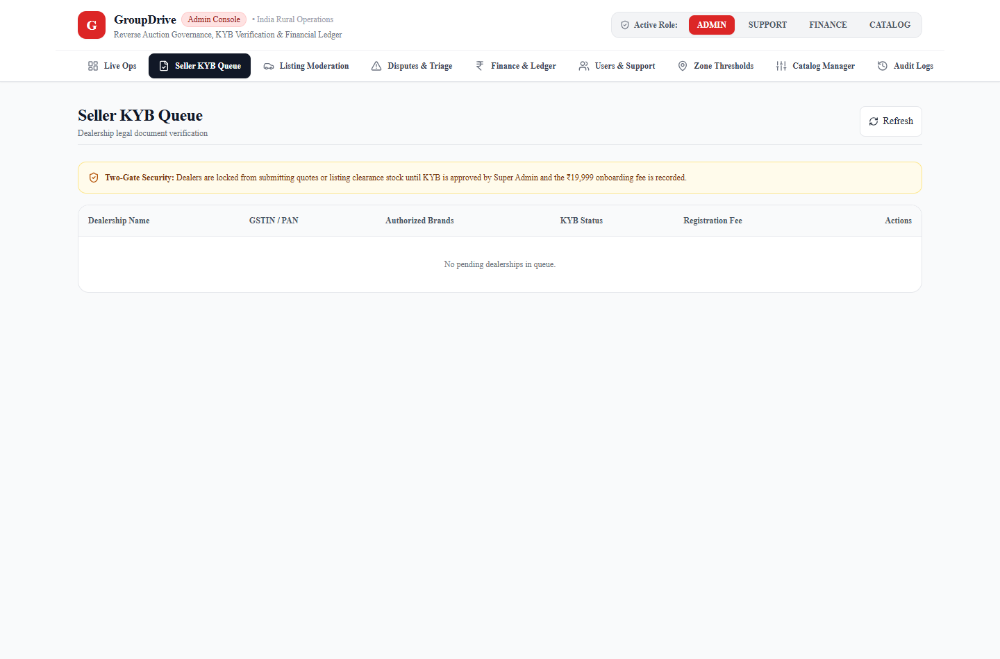

- Inspect uploaded GST certificates, PAN cards, and OEM dealership agreements in a high-resolution PDF previewer.
- Verify trade credentials against state transport authority registries.
- One-click approval or rejection with documented audit notes.

---

### Step 3: Clearance Listing Moderation
Protects buyers by auditing dealer demo cars and clearance stock before public visibility.

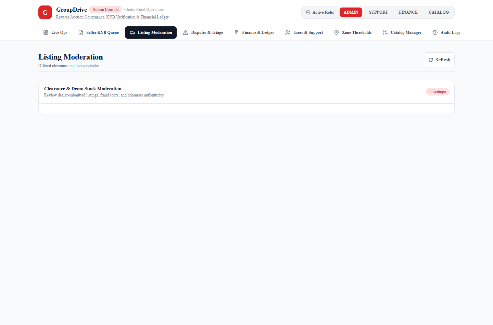

- Cross-checks VIN numbers against theft and total-loss insurance registers.
- Validates that advertised discounts reflect genuine reductions against baseline ex-showroom prices.

---

### Step 4: Double-Entry Financial Ledger Explorer
Provides complete financial transparency, tracking every rupee held in escrow, platform commission earned, and dealer settlements executed.

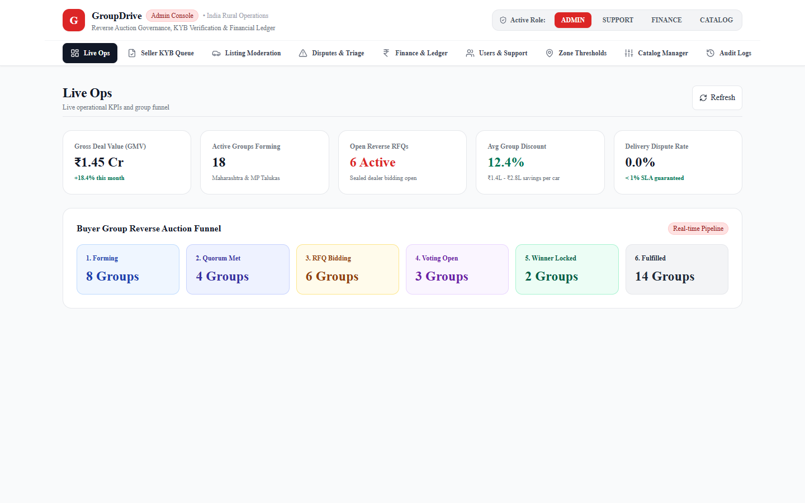

- **Debits == Credits Equilibrium**: Enforces double-entry balance across all platform accounts.
- **1% Platform Revenue**: Automatically accrues 1% take-rate upon vehicle fulfillment.
- **CSV Export**: Generates audit-ready spreadsheets for external statutory audits.

---

### Step 5: Fast-Forward Demo Simulator
For testing and presentations, platform administrators can fast-forward auction timers in seconds:

1. Navigate to `/demo` on any running portal.
2. Select an active group (e.g., Tata Nexon EV Satara Cohort).
3. Click **"Trigger Quorum Now"** to advance from `FORMING` to `QUORUM_REACHED`.
4. Click **"Close Bidding Now"** to instantly expire the 48-hour bidding clock and unseal quotes.
5. Click **"Complete Delivery & Settle"** to simulate vehicle handover, OTP entry, and double-entry escrow disbursement.

---

## 4. Frequently Asked Questions (FAQ)

### For Buyers
- **Q: Is my ₹10,000 token refundable if I change my mind?**  
  *A:* Yes. Your token hold is fully refundable up until the moment the winning dealer allocates your vehicle's factory VIN number.
- **Q: How is my car delivered to my village?**  
  *A:* Vehicles are transported on dedicated single-car flat-bed carriers to prevent odometer mileage accumulation, delivered directly to your doorstep.

### For Dealers
- **Q: Can other dealers see my bid during the reverse auction?**  
  *A:* No. All bids are encrypted in the database. Nobody—not even platform administrators—can view bids until the 48-hour window closes.
- **Q: When do I receive the balance vehicle payment?**  
  *A:* The balance on-road amount is paid either via direct bank transfer or via pre-approved auto loan disbursement directly to your bank account prior to vehicle dispatch.

### For Operations & Compliance
- **Q: How does GroupDrive comply with Indian e-commerce tax laws?**  
  *A:* GroupDrive complies with Section 194-O of the Income Tax Act (1% TDS on gross e-commerce marketplace transactions) and Section 52 of the CGST Act (TCS compliance).
